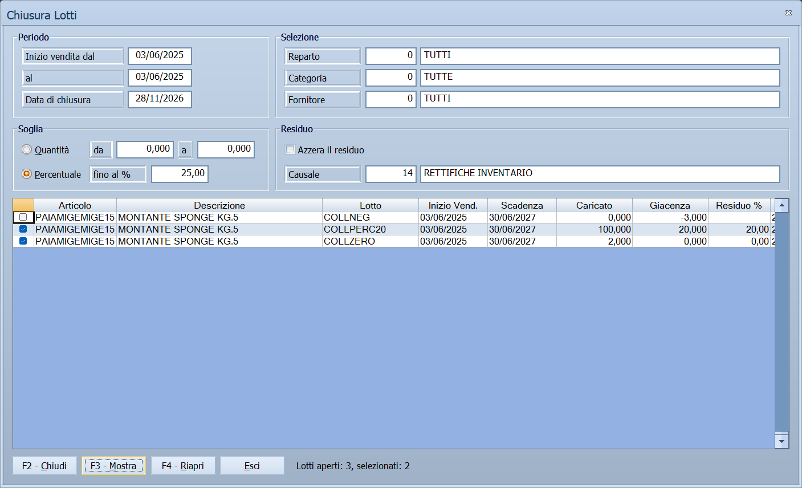

# Chiusura lotti

Chiude in un colpo solo i lotti finiti, invece di scrivere la **Fine Vendita**
lotto per lotto. Si scelgono per periodo di inizio vendita e per quanto ne
resta, si controlla l'elenco, e se serve si toglie anche il piccolo residuo
che il calo peso lascia sulla carta.

!!! info "In sintesi"

    - **Percorso:** Menu ▸ Archivi ▸ Articoli ▸ Chiusura Lotti
    - **Scorciatoia:** ++f3++ mostra, ++f2++ chiude, ++f4++ riapre, ++esc++ esce
    - **Permessi richiesti:** nessun profilo predefinito; le singole voci di menu si abilitano per ogni utente da [Archivi ▸ Utenti](utenti.md). Per riaprire serve che l'utente possa cancellare

---

## A cosa serve

Un lotto resta proponibile in vendita finché non ha la sua **Fine Vendita**.
Se nessuno la scrive, l'elenco dei lotti da cui scegliere si riempie di lotti
finiti da mesi. Questa maschera li chiude in blocco: tutti i lotti iniziati in
un periodo che sono a zero, oppure che hanno un residuo sotto una soglia.

Sui prodotti venduti a peso, come salumi e formaggi, il lotto finito di fatto
lascia quasi sempre un residuo piccolo: il pecorino da 30 kg venduto a fette
chiude con 0,420 kg che non esistono più. Chiudere il lotto senza toglierlo
lascerebbe quella quantità nella giacenza e nel valore dell'articolo, dove
nessuno la vedrebbe più. Con **Azzera il residuo** la chiusura scrive anche il
movimento di calo peso che porta a zero lotto e articolo.

Una chiusura fatta per sbaglio si annulla con **Riapri**, che toglie anche i
movimenti di azzeramento.

## Prerequisiti

Prima di usare questa maschera occorre:

- avere la **gestione dei lotti attiva** nella [ditta](ditte.md): senza, la
  voce non c'è nel menu. Non c'è nemmeno nella
  [versione Ortofrutta](../versioni/ortofrutta/index.md), dove il lotto è il
  numero del carico e si gestisce come prima;
- lavorare sugli **archivi dell'anno corrente**;
- per l'azzeramento, avere una [causale di magazzino](../magazzino/causali-magazzino.md)
  adatta. La maschera propone quella indicata come **Inventario da Lettore**
  nella scheda **Magazzino** della [ditta](ditte.md), la stessa delle
  rettifiche della [chiusura dell'inventario](../inventario/chiusura-inventario.md).

## La maschera

In alto quattro riquadri: **Periodo** e **Selezione** dicono quali lotti
guardare, **Soglia** quali spuntare, **Residuo** se azzerarne il residuo.
Sotto c'è la griglia, un lotto per riga con la spunta nella prima colonna, e in
fondo i pulsanti con il conteggio dei lotti in lista e di quelli spuntati:
*Lotti aperti: N, selezionati: M*, oppure *Lotti chiusi il gg/mm/aaaa: N,
selezionati: M* quando la lista è quella da riaprire.

## Campi

### Periodo

| Campo | Obbl. | Descrizione | Valori ammessi |
|---|:---:|---|---|
| **Inizio vendita dal** | ● | Prima data di **Inizio Vendita** dei lotti da considerare. Propone il primo giorno dell'esercizio. I lotti senza data di inizio vendita restano sempre fuori. | data |
| **al** | ● | Ultima data di inizio vendita. Propone oggi. Non può essere prima della data **dal**. | data |
| **Data di chiusura** | ● | La data che diventa la **Fine Vendita** dei lotti chiusi, e quella dei movimenti di azzeramento. Propone oggi. Deve essere oggi o una data passata, e cadere nell'esercizio in corso. Con **Riapri** è il giorno della chiusura da annullare. | data |

### Selezione

Tutti facoltativi: lasciati a zero valgono `TUTTI` (`TUTTE` per la categoria).

| Campo | Obbl. | Descrizione | Valori ammessi |
|---|:---:|---|---|
| **Reparto** | | Solo i lotti degli articoli di questo [reparto](../magazzino/reparti.md). | codice |
| **Categoria** | | Solo i lotti degli articoli di questa [categoria merceologica](../magazzino/categorie-merceologiche.md). | codice |
| **Fornitore** | | Solo i lotti con almeno un carico da questo [fornitore](anagrafica-fornitori.md). | codice |

### Soglia

Decide quali lotti arrivano in griglia già spuntati. Si sceglie uno dei due
tipi; il valore dell'altro non si può scrivere.

| Campo | Obbl. | Descrizione | Valori ammessi |
|---|:---:|---|---|
| **Quantità** **da** … **a** | | Spunta i lotti con una giacenza compresa fra i due valori, estremi inclusi. Propone `0` e `0`: i lotti esauriti esattamente. Da tastiera si sceglie con ++alt+q++. | quantità, anche negative |
| **Percentuale** **fino al %** | | Spunta i lotti il cui residuo, in percentuale su quanto è stato caricato, non supera il valore. Con `3` passano il salame da 1 kg che ha lasciato 20 g e la forma da 30 kg che ha lasciato 0,9 kg, cosa che una soglia in chili non può fare. Da tastiera si sceglie con ++alt+p++. | percentuale |

### Residuo

| Campo | Obbl. | Descrizione | Valori ammessi |
|---|:---:|---|---|
| **Azzera il residuo** | | Spenta all'apertura. Accesa, la chiusura scrive anche i movimenti che portano a zero il lotto. Spenta, il lotto si chiude e basta. | sì/no |
| **Causale** | ● con l'azzeramento | La causale dei movimenti di azzeramento. Si può scrivere solo con **Azzera il residuo** acceso. | codice |

### La griglia

| Colonna | Contenuto |
|---|---|
| *(spunta)* | Le righe spuntate sono quelle su cui agiscono **Chiudi** e **Riapri**. Si mettono e si tolgono a mano. |
| **Articolo**, **Descrizione** | L'articolo del lotto. |
| **Lotto**, **Inizio Vend.**, **Scadenza** | Il lotto e le sue date. |
| **Chiusura** | La **Fine Vendita** del lotto. Compare solo nella lista dei lotti da riaprire. |
| **Caricato** | Quanto è entrato con i carichi del lotto. |
| **Giacenza** | Quanto ne resta, sommando **tutti i depositi**. |
| **Residuo %** | La giacenza in percentuale sul caricato. Vuota se il lotto non ha carichi. |
| **Ultimo Mov.** | La data dell'ultimo movimento del lotto. |

## Pulsanti e comandi

| Comando | Scorciatoia | Effetto |
|---|---|---|
| **F3 - Mostra** | ++f3++ | Carica in griglia i lotti aperti a oggi che rispettano i criteri. |
| **F2 - Chiudi** | ++f2++ | Chiude i lotti spuntati, dopo la conferma. È attivo solo sulla lista dei lotti aperti, con almeno una riga spuntata. |
| **F4 - Riapri** | ++f4++ | In due tempi: la prima volta mostra i lotti chiusi nella **Data di chiusura**, la seconda riapre quelli spuntati. |
| **Esci** | ++esc++ | Chiude la maschera. |
| Guida | ++f1++ | Apre questa pagina. |
| Elenco valori | ++f10++, ++space++ o doppio clic | Su **Reparto**, **Categoria**, **Fornitore** e **Causale**, apre l'elenco da cui scegliere. |
| Consultazione | ++f11++ | Apre la finestra **Consultazione**. |
| Calcolatrice | ++f12++ | Apre la calcolatrice. |

## Come si fa

### Chiudere i lotti esauriti

1. Apri **Menu ▸ Archivi ▸ Articoli ▸ Chiusura Lotti**.
2. Indica in **Inizio vendita dal** e **al** il periodo dei lotti da
   controllare.
3. Lascia la soglia su **Quantità** da `0` a `0`.
4. Premi **F3 - Mostra**.
5. Scorri la griglia e togli la spunta ai lotti che vuoi lasciare aperti.
6. Premi **F2 - Chiudi** e rispondi **Sì** a *Vuoi chiudere N lotti ?*.
7. Il resoconto dice quanti lotti sono stati chiusi e quali sono stati saltati,
   con il motivo; la griglia si ricarica senza i lotti chiusi.

### Chiudere i lotti con il calo peso e azzerarne il residuo

1. Apri **Chiusura Lotti** e indica il periodo.
2. Scegli **Percentuale** e scrivi in **fino al %** il calo che consideri
   normale, per esempio `3`.
3. Accendi **Azzera il residuo** e controlla la **Causale** proposta.
4. Premi **F3 - Mostra** e controlla le spunte.
5. Premi **F2 - Chiudi** e rispondi **Sì** a *Vuoi chiudere N lotti e
   azzerarne il residuo con la causale C ?*.
6. Il resoconto dice anche quanti lotti sono stati azzerati e con quanti
   movimenti, ed elenca ogni lotto azzerato con la quantità tolta.

### Riaprire i lotti chiusi per sbaglio

1. Apri **Chiusura Lotti**.
2. Indica il periodo di inizio vendita e, in **Data di chiusura**, il giorno
   in cui sono stati chiusi.
3. Premi **F4 - Riapri**: la griglia mostra i lotti chiusi in quel giorno,
   tutti spuntati, con la colonna **Chiusura**.
4. Togli la spunta a quelli che devono restare chiusi.
5. Premi di nuovo **F4 - Riapri** e rispondi **Sì** a *Vuoi riaprire N lotti
   chiusi il gg/mm/aaaa ?*.
6. Il resoconto dice quanti lotti sono stati riaperti e quanti movimenti di
   azzeramento sono stati cancellati.

## Controlli e messaggi

| Messaggio | Causa | Cosa fare |
|---|---|---|
| *Operazione disponibile solo su archivi anno corrente.* | Hai aperto la voce di menu lavorando su un esercizio precedente. | Passa all'anno corrente e riapri la maschera. |
| *Indicare l'intervallo delle date di inizio vendita.* | Manca una delle due date di inizio vendita, oppure **al** è prima di **dal**. | Correggi il periodo. |
| *Indicare la data di chiusura.* | La **Data di chiusura** è vuota. | Scrivila. |
| *La data di chiusura non può essere successiva a oggi.* | Hai indicato una data futura. Una chiusura programmata si scrive solo nella **Fine Vendita** del singolo lotto. | Indica oggi o una data passata. |
| *La data di chiusura deve essere nell'esercizio in corso.* | La data cade in un altro anno. | Indica una data dell'esercizio in corso. |
| *Nessun lotto aperto con questi criteri.* | **F3 - Mostra** non ha trovato lotti. | Allarga il periodo, la soglia o la selezione. |
| *I criteri sono cambiati: la lista è stata ricaricata. Controllarla, poi ripetere il comando.* | Dopo aver caricato la lista hai cambiato una data, la soglia o la selezione, e hai premuto **Chiudi** o **Riapri**. Non è stato chiuso né riaperto nulla. | Controlla la lista ricaricata e premi di nuovo il comando. |
| *Nessun lotto selezionato.* | Non c'è nessuna riga spuntata. | Spunta i lotti su cui agire. |
| *La Causale per l' inventario non è impostata o non è valida.* | **Azzera il residuo** è acceso e la **Causale** è vuota o non esiste. | Scegli una causale dall'elenco. |
| *Se il movimento è di tipo SCARICO impostare ESISTENZA -* | La causale è di scarico ma non sottrae dall'esistenza. | Scegli un'altra causale o correggi la [causale](../magazzino/causali-magazzino.md). |
| *Se il movimento è di tipo CARICO impostare ESISTENZA +* | La causale è di carico ma non somma all'esistenza. | Scegli un'altra causale o correggila. |
| *La causale indicata genera un movimento in un altro deposito e non può essere usata.* | È una causale di trasferimento, con deposito e causale di destinazione. Compare già scegliendola dall'elenco. | Scegli una causale che non trasferisca merce. |
| *Vuoi chiudere N lotti ?* | Conferma prima di chiudere, senza azzeramento. | **Sì** procede. La risposta preimpostata è **No**. |
| *Vuoi chiudere N lotti e azzerarne il residuo con la causale C ?* | Conferma prima di chiudere con l'azzeramento. | **Sì** procede. La risposta preimpostata è **No**. |
| *Lotti chiusi: N* *Lotti azzerati: N (movimenti: M)* *Lotti saltati (N):* | Il resoconto della chiusura. La seconda riga c'è solo con l'azzeramento, ed è seguita dai lotti azzerati, una riga *articolo / lotto: quantità* ciascuno: la quantità tolta, con tre decimali e con il segno (negativa per un lotto che era sotto zero). L'elenco dei saltati, una riga *articolo / lotto: motivo* ciascuno, c'è solo se ce ne sono. Dopo venti righe ogni elenco prosegue con *... e altri N*. | Leggi il motivo dei lotti saltati: i motivi sono qui sotto. |
| *giacenza cambiata dopo l'anteprima* | Nel resoconto, accanto a un lotto saltato: fra **Mostra** e **Chiudi** il lotto si è mosso, per esempio con una vendita. | Premi **F3 - Mostra**, controlla la nuova giacenza e ripeti la chiusura. |
| *data di chiusura precedente all'inizio vendita* | Nel resoconto: la **Data di chiusura** è prima dell'inizio vendita del lotto. | Chiudilo con una data successiva. |
| *movimenti successivi alla data di chiusura* | Nel resoconto: il lotto ha movimenti con una data successiva alla **Data di chiusura**. | Chiudilo con una data uguale o successiva al suo **Ultimo Mov.** |
| *lotto già chiuso* | Nel resoconto: nel frattempo il lotto è stato chiuso, per esempio da un altro utente, e oggi non è più aperto. | Nulla: il lotto tiene la data che ha. |
| *(il testo di un errore)* | Nel resoconto, accanto a un lotto saltato o non riaperto: scrivendo quel lotto c'è stato un errore, per esempio perché un altro utente lo ha cancellato, lo stava modificando o lo teneva bloccato. Il motivo è la prima riga del messaggio d'errore; nella versione web è il messaggio intero. Per quel lotto non è stato scritto niente, e l'operazione è andata avanti con gli altri. | Ripeti **Mostra** e l'operazione per quel lotto; se l'errore si ripete, segnalalo con il testo del motivo. |
| *Operazione interrotta: erano già stati chiusi N lotti.* | Hai premuto **Esci** nella finestra di avanzamento, oppure all'inizio o alla fine non è stato possibile collegarsi all'archivio. Un errore su un singolo lotto non interrompe l'operazione: il lotto finisce fra i saltati. Precede il resoconto. | I lotti contati restano chiusi; ripeti **Mostra** e **Chiudi** per gli altri. |
| *Nessun lotto chiuso in questa data.* | Il primo **F4 - Riapri** non ha trovato lotti chiusi nella **Data di chiusura**. | Controlla la data e il periodo di inizio vendita. |
| *Controllare i lotti chiusi nella data indicata, poi premere di nuovo Riapri.* | Il primo **F4 - Riapri** ha caricato i lotti chiusi in quella data. | Togli le spunte che non servono e premi di nuovo **F4 - Riapri**. |
| *Cancellazioni non abilitate per l' utente !* | La riapertura cancella i movimenti di azzeramento, e il tuo utente ha il blocco delle cancellazioni. | Fai riaprire da un utente abilitato, o fai togliere il blocco da [Utenti](utenti.md). |
| *Vuoi riaprire N lotti chiusi il gg/mm/aaaa ?* | Conferma prima di riaprire. | **Sì** procede. La risposta preimpostata è **No**. |
| *Lotti riaperti: N* *Movimenti di azzeramento cancellati: M* | Il resoconto della riapertura. Seguono, se ce ne sono, *Lotti non riaperti (N):* e *Lotti riaperti da rettificare a mano (N):*. | Leggi i due elenchi. |
| *lotto non chiuso in quella data* | Nel resoconto della riapertura, fra i lotti non riaperti: nel frattempo il lotto è stato riaperto o chiuso con un'altra data. | Nulla, oppure cercalo con la sua data di chiusura. |
| *movimento di azzeramento in un esercizio chiuso: rettificare a mano* | Nel resoconto, fra i lotti riaperti da rettificare: il lotto è stato riaperto, ma il suo movimento di azzeramento sta in un esercizio già chiuso e non è stato cancellato. | Se il residuo va rimesso, fallo con un movimento di rettifica dai [movimenti di magazzino](../magazzino/movimenti-magazzino.md). |
| *Operazione interrotta: erano già stati riaperti N lotti.* | Hai premuto **Esci** nella finestra di avanzamento, oppure all'inizio o alla fine non è stato possibile collegarsi all'archivio. | I lotti contati restano riaperti; ripeti **Riapri** per gli altri. |

## Note

!!! warning "L'azzeramento scrive movimenti veri"

    Con **Azzera il residuo** acceso, per ogni lotto la chiusura scrive un
    movimento per ciascun deposito e sezione in cui il lotto ha un residuo
    diverso da zero, positivo o negativo (nella versione Taglie e Colori anche
    per taglia e colore). Il movimento ha la causale della maschera, la
    **Data di chiusura** e la quantità che porta a zero il residuo, e cambia
    la giacenza e il valore dell'articolo come ogni altro movimento. È valorizzato
    al costo medio dell'articolo nell'esercizio, calcolato su rimanenza
    iniziale e caricato di quel deposito; se non c'è, all'ultimo prezzo
    d'acquisto.

    Secondo la causale, i movimenti possono finire sotto un documento:

    - con una causale di scarico verso i clienti, sotto uno **scontrino**;
    - con una causale di carico dai fornitori, sotto un **carico**;
    - con le altre causali, sotto nessun documento.

    Un'operazione usa un documento solo, e ne apre uno nuovo ogni 500
    movimenti. Se la causale ha **Aggiorna Data Inventario**, il movimento
    sposta anche la data dell'ultimo inventario dell'articolo.

!!! warning "La riapertura annulla solo i movimenti dell'esercizio in corso"

    **Riapri** toglie la **Fine Vendita** e cancella i movimenti di
    azzeramento scritti dalla chiusura in quel giorno, ma solo quelli
    dell'esercizio in corso: per un lotto chiuso in un esercizio precedente il
    resoconto dice che il residuo va rettificato a mano. Non cancella nessun
    altro movimento, nemmeno una rettifica fatta a mano lo stesso giorno con la
    stessa causale. Lo scontrino o il carico che conteneva i movimenti resta in
    archivio.

!!! info "Quando un lotto è chiuso"

    Un lotto è chiuso **dal giorno della sua Fine Vendita**, compreso. Una
    **Fine Vendita** messa a oggi lo toglie subito dall'elenco dei lotti da cui
    si sceglie nei documenti e nella [produzione](../magazzino/produzione.md),
    non da domani. Una **Fine Vendita** futura è una chiusura programmata: il
    lotto resta vendibile fino al giorno prima.

    Nei documenti conta la data del documento: un documento datato prima della
    **Fine Vendita** può ancora usare il lotto.

!!! info "Quali lotti compaiono in griglia"

    Con **F3 - Mostra** entrano i lotti con l'inizio vendita nel periodo, che
    **oggi** sono ancora aperti, cioè senza **Fine Vendita** o con una **Fine
    Vendita** futura, e che rispettano la **Selezione**. Un lotto chiuso ieri
    non compare anche se la **Data di chiusura** è di una settimana fa; uno con
    una chiusura programmata compare, e la chiusura gli anticipa la **Fine
    Vendita** alla **Data di chiusura**. Fra questi:

    - quelli nella **Soglia** compaiono **spuntati**;
    - quelli con giacenza negativa, e quelli senza carichi ma con una
      giacenza, compaiono **senza spunta**, perché vanno guardati prima di
      chiuderli. Con la soglia in quantità e un minimo negativo, i negativi
      dentro l'intervallo sono spuntati;
    - gli altri non compaiono.

    Una riga spuntata a mano si chiude anche se è fuori soglia: la scelta è
    tua. In **Riapri** la soglia non conta: compaiono tutti i lotti chiusi in
    quel giorno che rispettano il periodo e la selezione.

!!! info "Come si conta la giacenza del lotto"

    È la somma di **tutti i depositi**: un lotto che è a zero in negozio ma ha
    ancora merce in magazzino non è a zero. Si conta al netto della tara, come
    l'esistenza dell'articolo, così un solo movimento di azzeramento porta a
    zero insieme il lotto e l'articolo.

## Vedi anche

- [Anagrafica articoli](anagrafica-articoli.md)
- [Analisi e giacenza dei lotti](../analisi-dati/analisi-lotti.md)
- [Stampa lotti in scadenza e spostamenti codici a barre](stampe-lotti-e-barcode.md)
- [Causali di magazzino](../magazzino/causali-magazzino.md)
- [Chiusura dell'inventario](../inventario/chiusura-inventario.md)
