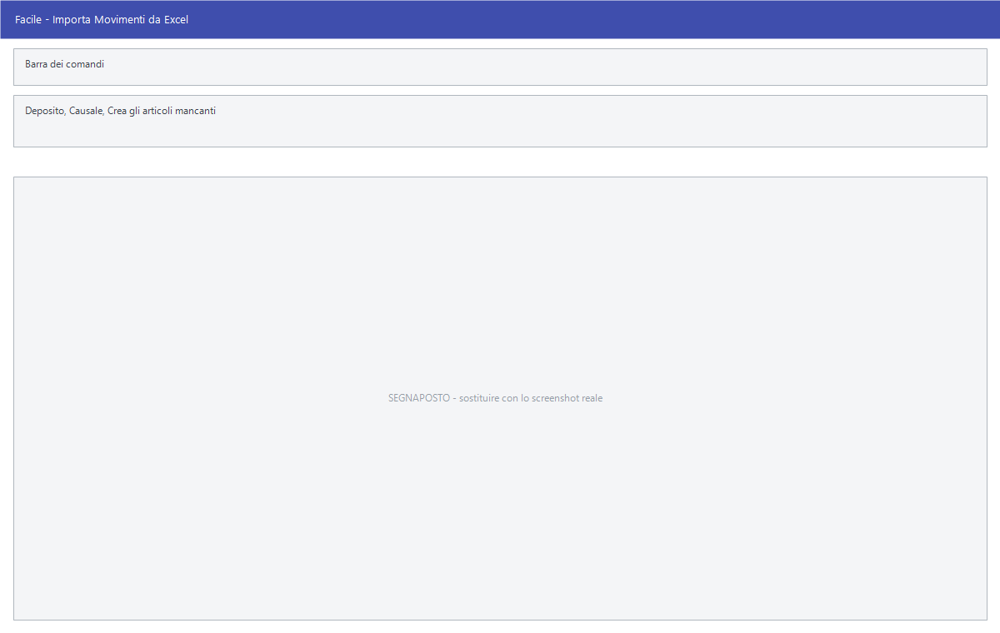

# Importa movimenti da Excel

Registra in una volta sola i movimenti di magazzino elencati in un foglio
Excel: le vendite di un punto vendita che lavora con un altro programma, un
carico arrivato come elenco, le rettifiche preparate fuori da Facile.

!!! info "In sintesi"

    - **Percorso:** Menu ▸ Magazzino ▸ Importa Movimenti da Excel
    - **Scorciatoia:** ++f2++ avvia l'importazione, ++esc++ esce, ++f10++ cerca deposito e causale
    - **Permessi richiesti:** nessun profilo predefinito; la voce si toglie o si lascia per ogni utente da [Archivi ▸ Utenti](../anagrafiche/utenti.md)

!!! note "La voce compare a tutti gli utenti"

    Facile ricorda, per ogni utente, le voci di menu che gli sono state
    **tolte**. Una voce nuova come questa non è in nessun elenco, quindi la
    vedono tutti, anche gli utenti creati prima. Se un utente non deve
    importare movimenti, togli la spunta alla voce nel suo menu.

---

## A cosa serve

Ogni riga del foglio diventa un movimento, come quelli che si registrano a
mano in [Inserimento Movimenti](movimenti-magazzino.md). Nella maschera scegli
il **deposito** e la **causale** che valgono per tutte le righe; il foglio può
cambiarli riga per riga.

L'importazione avviene in due tempi: prima il programma **controlla** tutto il
foglio senza scrivere niente e ti mostra cosa farebbe; solo se confermi
registra i movimenti. Un foglio con errori non lascia mai un'importazione a
metà.

## Prerequisiti

Prima di usare questa maschera occorre:

- avere i [depositi](depositi.md) e le
  [causali di magazzino](causali-magazzino.md) che il foglio userà;
- lavorare nell'**anno** dei movimenti: le righe con una data di un altro anno
  vengono scartate;
- se vuoi far creare gli articoli che mancano, avere impostati **Codice Iva**
  e **Unità di Misura** nei [parametri della ditta](../anagrafiche/ditte.md):
  sono quelli che ricevono gli articoli nuovi.

## La maschera

Una finestra piccola: deposito e causale in alto, la casella per gli articoli
mancanti, e i due pulsanti.

## Campi

| Campo | Obbl. | Descrizione | Valori ammessi |
|---|:---:|---|---|
| **Deposito** | ● | Il [deposito](depositi.md) da movimentare, per le righe che non ne indicano uno loro. Propone il deposito attivo della ditta. Accanto compare la descrizione. | codice; ++f10++ apre l'elenco |
| **Causale** | ● | La [causale di magazzino](causali-magazzino.md) dei movimenti, per le righe che non ne indicano una loro. Propone la causale **Vendite** dei parametri della ditta. Decide se i movimenti sono carichi o scarichi. | codice; ++f10++ apre l'elenco |
| **Crea gli articoli mancanti** | | Spuntata, un codice che non esiste in anagrafica diventa un articolo nuovo, con la descrizione presa dal foglio. Non spuntata, la riga viene scartata. | sì / no |

La colonna **Obbl.** segna con ● i campi che il programma richiede
obbligatoriamente per avviare l'importazione.

## Pulsanti e comandi

| Comando | Scorciatoia | Effetto |
|---|---|---|
| **F2 - OK** | ++f2++ | Controlla deposito e causale, chiede il file e avvia il controllo del foglio. |
| **Esci** | ++esc++ | Chiude la maschera senza importare niente. |
| **Guida** | ++f1++ | Apre questa pagina. |
| **Consultazione** | ++f11++ | Apre la consultazione. |
| **Calcolatrice** | ++f12++ | Apre la calcolatrice. |

## Come si fa

### Importare i movimenti da un foglio Excel

1. Prepara il foglio come spiegato in
   [Il foglio Excel da importare](#il-foglio-excel-da-importare). Puoi partire
   dal [modello già impostato](../../assets/modelli/movimenti-importazione.xlsx):
   cancella le tre righe d'esempio prima di scrivere le tue.
2. Chiudi il foglio in Excel: un file ancora aperto non si può leggere.
3. Apri **Menu ▸ Magazzino ▸ Importa Movimenti da Excel**.
4. Controlla **Deposito** e **Causale**, e spunta **Crea gli articoli
   mancanti** se il foglio contiene articoli nuovi.
5. Premi **F2 - OK** e scegli il file, `.xlsx` o `.xls`. La ricerca parte dalla
   cartella `in`.
6. Attendi la fine del controllo. **Esci**, nella finestra di avanzamento, lo
   interrompe senza registrare niente.
7. Leggi il riepilogo: righe lette, movimenti da inserire, articoli da creare,
   righe scartate. Se ci sono righe scartate, il programma apre da solo il file
   di log con il motivo di ognuna.
8. Rispondi **Sì** per importare, **No** per lasciar perdere e correggere il
   foglio. Se ci sono righe scartate, è già selezionato **No**.
9. A importazione finita, un ultimo riepilogo riporta i movimenti inseriti e
   gli articoli creati, e la maschera si chiude. Se sono stati creati articoli
   o qualche movimento non è entrato, il log si riapre da solo.

I movimenti importati si ritrovano in
[Modifica Movimenti](movimenti-magazzino.md) e nelle
[stampe dei movimenti](stampe-movimenti-magazzino.md). Se ripeti l'importazione
con lo stesso foglio, i movimenti entrano **una seconda volta**: per
recuperare le righe scartate, prepara un foglio con le sole righe mancanti.

### Il foglio Excel da importare

Il programma legge il **primo foglio** del file. La **prima riga** porta i nomi
delle colonne; dalla seconda in giù, un movimento per riga.

| CODICE | DESCRIZIONE | DATA | QUANTITA | PREZZO | DEPOSITO | CAUSALE |
|---|---|---|--:|--:|--:|--:|
| 000123 | PASTA DI SEMOLA 500 G | 02/03/2026 | 12 | 1,20 | | |
| 8001234567890 | OLIO EXTRAVERGINE 1 L | 02/03/2026 | 3 | 8,90 | 2 | |
| ART-45 | DETERSIVO PIATTI 750 ML | 03/03/2026 | 5 | 1,50 | | |

Le colonne sono riconosciute dal **nome** scritto nell'intestazione, non dalla
posizione: l'ordine non conta, e non conta se il nome è scritto in maiuscolo o
in minuscolo. Qualunque altra colonna viene ignorata.

| Colonna | Obbl. | Contenuto |
|---|:---:|---|
| `CODICE` | ● | Il codice dell'articolo, uno dei suoi codici a barre o il codice che gli dà il fornitore. Si possono scrivere **più codici separati da virgola**: vale il primo che il programma trova. |
| `DATA` | ● | La data del movimento. Deve cadere nell'anno di lavoro. |
| `QUANTITA` | ● | La quantità del movimento, senza segno: carico o scarico lo decide la causale. Va scritta **senza accento**: `QUANTITÀ` non viene riconosciuta. Se il codice è il codice a barre di una **confezione**, la quantità viene moltiplicata per i pezzi della confezione: 2 cartoni da 6 diventano 12 pezzi. |
| `PREZZO` | ● | Il prezzo del movimento. In un **carico** è anche il costo d'acquisto registrato sul movimento; in uno scarico il costo resta l'ultimo prezzo d'acquisto dell'articolo. La colonna deve esserci, la cella può restare vuota. |
| `DEPOSITO` | | Il codice del [deposito](depositi.md) della riga. Vuota o zero, vale quello della maschera. |
| `CAUSALE` | | Il codice della [causale](causali-magazzino.md) della riga. Vuota o zero, vale quella della maschera. |
| `DESCRIZIONE` | | La descrizione dell'articolo da creare, se il codice non esiste. Obbligatoria quando è spuntato **Crea gli articoli mancanti**; altrimenti viene ignorata. |

**Come scrivere i valori.**

- **Codici con zeri iniziali**: la colonna `CODICE` va formattata come
  **Testo** prima di scrivere i codici, altrimenti Excel trasforma `000123` in
  `123`. Nel modello la colonna è già impostata così.
- **Codici a barre**: vanno bene anche come numeri; il numero salvato resta
  intero e viene letto bene. Un codice a barre che comincia con zero, scritto
  come numero, perde lo zero: se così non si trova, il programma lo cerca di
  nuovo completandolo a 13 cifre.
- **Date**: vanno bene le celle in formato data di Excel e le date scritte come
  testo, per esempio `02/03/2026`.
- **Numeri**: quantità e prezzi possono avere la virgola o il punto come
  separatore dei decimali.
- **Righe vuote**: quelle senza codice, data e quantità non contano e non
  vengono segnalate.

### Leggere il file di log

Il log si chiama come il foglio, con estensione `.txt`, e sta nella cartella
`log` del programma. Il percorso esatto compare nei riepiloghi. Ogni riga dice
il **numero di riga del foglio** e il motivo:

| Motivo | Cosa fare |
|---|---|
| *Data mancante o non valida* | Scrivi la data in una cella di tipo data, o come testo `gg/mm/aaaa`. |
| *Data dell'anno …, diverso dall'anno di lavoro …* | Importa quelle righe lavorando nel loro anno. |
| *Quantità a zero* | Indica la quantità, o togli la riga. |
| *Deposito … inesistente* | Correggi il codice nella colonna `DEPOSITO`, o lasciala vuota per usare quello della maschera. |
| *Causale … inesistente* | Correggi il codice nella colonna `CAUSALE`, o lasciala vuota. |
| *Causale … non coerente: uno scarico deve togliere dall'esistenza, un carico aggiungere* | La causale indicata nella riga muoverebbe il magazzino nel verso sbagliato: correggila nelle [causali di magazzino](causali-magazzino.md) o usane un'altra. |
| *Codice mancante* | Scrivi il codice dell'articolo. |
| *Articolo … non trovato* | Il codice non esiste: correggilo, o spunta **Crea gli articoli mancanti** e aggiungi la colonna `DESCRIZIONE`. |
| *Articolo … non trovato e descrizione vuota: articolo non creato* | Scrivi la descrizione nella riga. |
| *Articolo … non trovato e codice troppo lungo per crearlo (massimo 15 caratteri)* | Il codice va bene per cercare un codice a barre, non per creare un articolo: crealo a mano con un codice più corto. |
| *Errore nel controllo della riga: …* | Durante il controllo l'archivio ha dato un errore su questa riga, riportato per intero dopo i due punti. La riga è scartata, il controllo prosegue. | Se l'errore si ripete, manda il log all'assistenza: il testo dice in che punto del programma è successo. |
| *Articolo … non creato, movimento non inserito: …* | L'articolo nuovo non si è potuto registrare; dopo i due punti c'è l'errore dell'archivio, per esempio *In archivio è già presente un record con lo stesso codice.* Le altre righe con lo stesso codice vengono saltate senza riprovare. | Cerca l'articolo in [anagrafica](../anagrafiche/anagrafica-articoli.md): se c'è già, controlla come è scritto il codice nel foglio. Poi importa un foglio con le sole righe mancanti. |
| *Articolo … non creato (vedi l'errore sulla prima riga che lo usa): movimento non inserito* | La stessa cosa, sulle righe successive con quel codice. | Come sopra. |
| *Articolo …: movimento non inserito: …* | La registrazione del movimento ha dato un errore, riportato dopo i due punti. La riga è saltata, l'importazione prosegue. | Importa la riga di nuovo, da sola; se l'errore si ripete, manda il log all'assistenza. |
| *Articolo … non più presente in archivio: movimento non inserito* | L'articolo c'era al momento del controllo, ma è stato cancellato prima che confermassi, per esempio da un altro utente. Il programma non lo ricrea. Se l'articolo serve, rimettilo in [anagrafica](../anagrafiche/anagrafica-articoli.md) e importa un foglio con le sole righe mancanti. |

Dopo l'importazione, il log riporta anche gli **articoli creati**
(*Creato articolo …*), uno per riga. Se interrompi l'importazione con
**Esci**, le righe non ancora elaborate non compaiono nel log: il riepilogo
finale dice quanti movimenti sono entrati.

## Controlli e messaggi

| Messaggio | Causa | Cosa fare |
|---|---|---|
| *Deposito non impostato o non valido!* | **Deposito** è vuoto o il codice non esiste. | Indica un deposito; ++f10++ apre l'elenco. |
| *Causale non impostata o non valida!* | **Causale** è vuota o il codice non esiste. | Indica una causale; ++f10++ apre l'elenco. |
| *Se il movimento è di tipo SCARICO impostare ESISTENZA -* | La causale della maschera è di scarico ma non toglie dall'esistenza. | Correggi la [causale di magazzino](causali-magazzino.md), o scegline un'altra. |
| *Se il movimento è di tipo CARICO impostare ESISTENZA +* | La causale della maschera è di carico ma non aggiunge all'esistenza. | Come sopra. |
| *Impossibile inizializzare il file excel!* | Il programma non riesce a preparare la lettura del foglio. | Riprova; se si ripete, segnalalo all'assistenza. |
| *Impossibile aprire il file excel!* | Il file è aperto in Excel, danneggiato o non è un foglio Excel. | Chiudi il file in Excel e riprova, o salvalo di nuovo come `.xlsx`. |
| *Colonna CODICE non trovata nel file excel!  Impossibile continuare* | Nella prima riga del foglio manca l'intestazione `CODICE`. | Aggiungi la colonna, o porta l'intestazione sulla prima riga. |
| *Colonna DATA non trovata nel file excel!  Impossibile continuare* | Manca l'intestazione `DATA`. | Aggiungi la colonna. |
| *Colonna QUANTITA non trovata nel file excel!  Impossibile continuare* | Manca l'intestazione `QUANTITA`, o è scritta con l'accento. | Intitola la colonna `QUANTITA`, senza accento. |
| *Colonna PREZZO non trovata nel file excel!  Impossibile continuare* | Manca l'intestazione `PREZZO`. | Aggiungi la colonna; le celle possono restare vuote. |
| *Colonna DESCRIZIONE non trovata nel file excel!  Serve per creare gli articoli mancanti: aggiungi la colonna o togli la spunta da Crea gli articoli mancanti.* | È spuntato **Crea gli articoli mancanti** ma il foglio non ha la colonna `DESCRIZIONE`. | Aggiungi la colonna, o togli la spunta: i codici che non esistono verranno scartati. |
| *Impossibile creare il file di log …!  Impossibile continuare* | La cartella `log` del programma non è scrivibile. | Verifica i permessi sulla cartella; se non sai come, rivolgiti all'assistenza. |
| *Controllo interrotto: nessun movimento importato.* | Hai premuto **Esci** durante il controllo. | Niente: l'archivio non è stato toccato. |
| *Controllo del file terminato.  Righe lette : … Movimenti da inserire : … Articoli da creare : … Righe scartate : …  Vuoi procedere con l'importazione ?* | Il controllo è finito. Se ci sono righe scartate, il messaggio indica anche il file di log, che si apre da solo. | **Sì** registra i movimenti validi; **No** non registra niente. |
| *… Nessun movimento da importare!* | Nessuna riga del foglio ha passato il controllo. | Leggi il log, correggi il foglio e riprova. |
| *Importazione terminata.  Movimenti inseriti : … Movimenti non inseriti : … Articoli creati : …* | L'importazione è finita. La riga *Movimenti non inseriti* compare solo se qualche riga ha dato errore. Se sono stati creati articoli o qualche movimento non è entrato, il messaggio indica il file di log, che si apre da solo. | Niente. Controlla gli articoli creati: hanno solo codice, descrizione, IVA e unità di misura. |
| *Importazione interrotta!  Movimenti inseriti : … Movimenti non inseriti : … Articoli creati : …* | Hai premuto **Esci** durante l'importazione. Il messaggio indica il file di log, che si apre da solo. | I movimenti già inseriti restano: per completare, importa un foglio con le sole righe mancanti. |

## Note

!!! warning "Gli articoli creati vanno completati"

    Un articolo creato dall'importazione ha soltanto il codice, la
    descrizione, l'aliquota IVA e l'unità di misura dei parametri della
    ditta: niente listini, categoria, fornitore. Prima di venderlo, apri la
    sua scheda in [anagrafica articoli](../anagrafiche/anagrafica-articoli.md)
    e completala.

!!! note "Un errore su una riga non ferma l'importazione"

    Se l'archivio rifiuta un articolo o un movimento, quella riga finisce nel
    log con l'errore completo e il programma passa alla successiva. Alla fine
    il riepilogo dice quanti movimenti non sono entrati e il log si apre da
    solo: le righe da recuperare sono tutte lì, con il numero di riga del
    foglio.

!!! note "La causale decide carico e scarico"

    Il foglio non dice se la merce entra o esce: lo decide la causale, quella
    della maschera o quella della colonna `CAUSALE`. Una stessa importazione
    può quindi contenere carichi e scarichi, se le righe hanno causali
    diverse.

## Vedi anche

- [Movimenti di magazzino](movimenti-magazzino.md)
- [Causali magazzino](causali-magazzino.md)
- [Depositi](depositi.md)
- [Stampe dei movimenti di magazzino](stampe-movimenti-magazzino.md)
