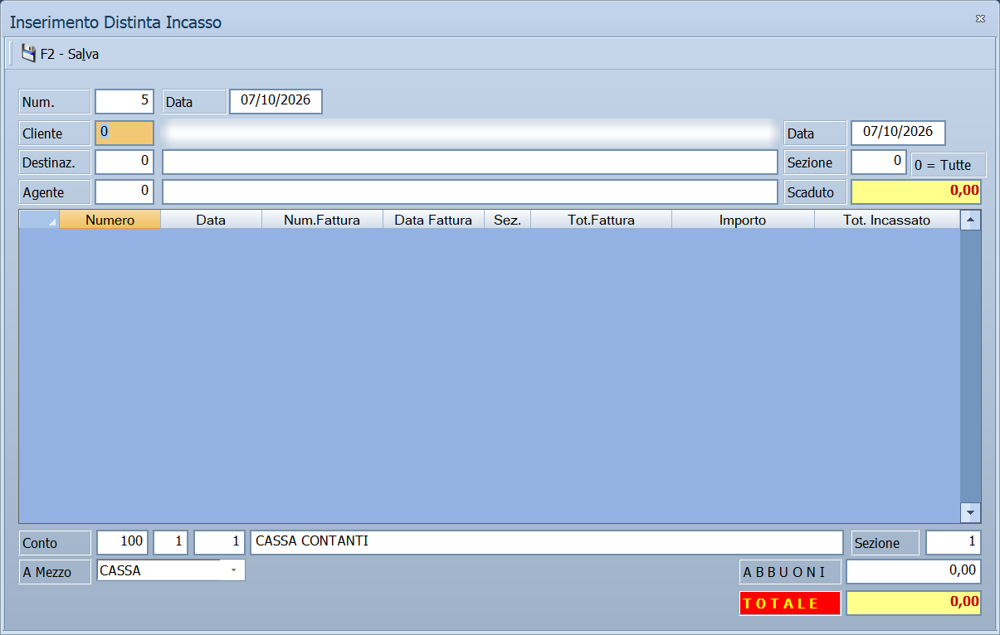

# Distinte di incasso e di pagamento

La distinta è il gesto con cui una o più scadenze vengono chiuse: si incassa
dal cliente o si paga il fornitore. La stessa maschera serve i due versi —
*Incasso Scadenze* dal lato clienti, *Pagamento Scadenze* dal lato fornitori.

!!! info "In sintesi"

    - **Percorso:**
        - Menu ▸ Scadenze ▸ Scadenziario Clienti ▸ Inserimento Distinta Incasso
        - Menu ▸ Scadenze ▸ Scadenziario Clienti ▸ Visualizza Distinta Incasso
        - Menu ▸ Scadenze ▸ Scadenziario Clienti ▸ Stampa Elenco Distinte Incasso
        - Menu ▸ Scadenze ▸ Scadenziario Clienti ▸ Acquisizione Incassi Agente
        - Menu ▸ Scadenze ▸ Scadenziario Clienti ▸ Ricezione Distinte Incasso dal Server FTP
        - Menu ▸ Scadenze ▸ Scadenziario Fornitori ▸ Inserimento Distinta Pagamento
        - Menu ▸ Scadenze ▸ Scadenziario Fornitori ▸ Visualizza Distinta Pagamento
        - Menu ▸ Scadenze ▸ Scadenziario Fornitori ▸ Stampa Elenco Distinte Pagamento
    - **Scorciatoia:** ++f2++ salva, ++esc++ esce
    - **Permessi richiesti:** nessun profilo predefinito; le singole voci di menu si abilitano per ogni utente da [Archivi ▸ Utenti](../anagrafiche/utenti.md)

---

## A cosa serve

| Voce di menu | A cosa serve |
|---|---|
| **Inserimento Distinta Incasso** / **Pagamento** | Registra l'incasso dal cliente o il pagamento al fornitore, chiudendo le scadenze. |
| **Visualizza Distinta Incasso** / **Pagamento** | Riapre una distinta già registrata per consultarla o correggerla. |
| **Stampa Elenco Distinte Incasso** / **Pagamento** | Stampa l'elenco delle distinte di un periodo. |
| **Acquisizione Incassi Agente** | Porta dentro gli incassi che l'agente ha registrato in giro, da un file `.json`. |
| **Ricezione Distinte Incasso dal Server FTP** | Scarica le distinte compilate fuori sede. |

## Prerequisiti

Prima di registrare una distinta occorre avere le scadenze aperte, che si
consultano dalla [gestione scadenze](gestione-scadenze.md).

## La maschera

In alto gli estremi della distinta e il soggetto, poi i filtri con cui si
richiamano le scadenze da chiudere, e sotto l'elenco su cui si sceglie.

## Campi

| Campo | Obbl. | Descrizione | Valori ammessi |
|---|:---:|---|---|
| **Num.** | | Numero della distinta. Lo assegna il programma. | numero |
| **Data** | ● | Data della distinta. | data |
| **Fornitore** | ● | Il soggetto della distinta. Nello scadenziario clienti l'etichetta è **Cliente**. | codice |
| **Destinaz.** | | La destinazione merce, quando serve a distinguere. | codice |
| **Data** *(la seconda)* | | La data a cui riferire le scadenze da richiamare. | data |
| **Sezione** | | Restringe a una [sezione](../contabilita/sezioni.md). A fianco l'etichetta ricorda **0 = Tutte**. | codice, `0` per tutte |
| **Agente** | | Restringe alle scadenze di un [agente](../anagrafiche/anagrafica-agenti.md). | codice |
| **Scaduto** | | Limita alle scadenze già scadute. | attivo/non attivo |
| **Conto** | | Il conto su cui registrare l'incasso o il pagamento — la cassa, la banca. | codice |
| **Sezione** *(la seconda)* | | La sezione della registrazione. | codice |

## Pulsanti e comandi

| Comando | Scorciatoia | Effetto |
|---|---|---|
| **F2 - Salva** | ++f2++ | Registra la distinta e chiude le scadenze scelte. |
| **F8 - Documento** | ++f8++ | Apre l'anteprima del documento che ha generato la scadenza selezionata nell'elenco, anche se è di un altro anno. C'è sia mentre si incassa sia sulla distinta già registrata. |
| **Esci** | ++esc++ | Chiude senza salvare. |
| Elenco di scelta | ++f10++ o ++space++ | Sul campo con il codice, apre l'elenco da cui scegliere. |
| **Calcolatrice** | ++f12++ | Apre la calcolatrice. |
| **Consultazione** | ++f11++ | Apre la consultazione. |

## Come si fa

### Incassare da un cliente

1. Apri **Menu ▸ Scadenze ▸ Scadenziario Clienti ▸ Inserimento Distinta
   Incasso**.
2. Indica la **Data** della distinta e il **Cliente**.
3. Attiva **Scaduto** se vuoi vedere solo quello che è già in ritardo.
4. Scegli dall'elenco le scadenze che il cliente sta pagando.
5. Indica il **Conto** su cui l'incasso entra — la cassa o la banca.
6. Premi **F2 - Salva**.

### Vedere il documento di una scadenza

Nell'elenco la colonna **Num. Fattura** dice da quale documento viene la
scadenza; per vederne gli articoli non serve uscire dalla distinta.

1. Seleziona nell'elenco la riga della scadenza.
2. Premi **F8 - Documento**.
3. Si apre l'anteprima di stampa del documento, anche se è stato emesso in un
   anno diverso da quello su cui stai lavorando. Chiudila per tornare alla
   distinta, che resta com'era.

Il documento si apre solo per le scadenze nate da una fattura, da una nota di
credito o da un altro documento di vendita: per quelle inserite a mano nello
scadenzario, nate da una registrazione di prima nota o da uno scontrino,
Facile lo dice con un messaggio.

### Rivedere una distinta già fatta

1. Apri **Visualizza Distinta Incasso**.
2. Richiama la distinta dal numero.

### Registrare gli incassi raccolti dall'agente

1. Apri **Acquisizione Incassi Agente**.
2. Alla domanda *«Vuoi Collegarti al server FTP ?»* rispondi **Sì** per
   scaricare il file dal server, oppure **No** per sceglierlo a mano.
3. Avvia l'acquisizione e controlla le scadenze chiuse dalla
   [gestione scadenze](gestione-scadenze.md).

## Controlli e messaggi

| Messaggio | Causa | Cosa fare |
|---|---|---|
| *(nessun messaggio, solo un segnale acustico)* | Manca un campo obbligatorio, o la causale contabile indicata non va bene. | Compila il campo su cui si è posizionato il cursore. |
| *Nessuna Scadenza Selezionata!* | Si è premuto salva senza spuntare niente. | Scegli almeno una scadenza. |
| *Importo Selezionato Maggiore dell'Importo della Scadenza!* | Su una riga si è scritto più di quanto la scadenza vale. | Correggi l'importo: per gli acconti si scrive meno, non di più. |
| *Importo Selezionato Inferiore a Zero!* | Importo negativo su una riga. | Correggi. |
| *Importo Totale Selezionato Inferiore a Zero!  Vuoi Continuare?* | Il totale della distinta è negativo. | Succede con le note di credito. **Sì** registra lo stesso. La risposta preimpostata è **No**. |
| *L' importo indicato è superiore al totale delle scadenze !* | L'importo dell'incasso supera quello che c'è da incassare. | Correggi l'importo. |
| *Non è consentito utilizzare il Mastro Clienti o Fornitori !* | È stato indicato un conto del mastro clienti o fornitori dove non si può. | Scegli un altro [conto](../contabilita/conti.md). |
| *Vuoi stampare la Distinta?* | A registrazione avvenuta. | **Sì** stampa la distinta. |
| *Vuoi ristampare le Fatture/Note di Credito ?* | Dopo la registrazione. | **Sì** ristampa i documenti collegati. |
| *Ci sono Fatture/Note di Credito fatte in anni di esercizio diversi che non possono essere stampate da questo esercizio!* | Alcuni documenti sono di un altro anno. | Ristampali dall'anno in cui sono stati emessi. |
| *Selezionare nella tabella la scadenza di cui si vuole vedere il documento.* | Con **F8 - Documento**: nell'elenco non è selezionata nessuna riga. | Clicca sulla riga della scadenza e premi di nuovo **F8**. |
| *La scadenza della riga non è più presente nello scadenzario.* | Con **F8 - Documento**: nel frattempo la scadenza è stata cancellata. | Ricarica la distinta. |
| *La scadenza non è legata a un documento: è stata inserita a mano nello scadenzario.* | Con **F8 - Documento**: la scadenza non viene da un documento. | Nessuno: non c'è un documento da mostrare. |
| *La scadenza è stata generata dal movimento di Prima Nota n. …: non c'è un documento con gli articoli da mostrare.* | Con **F8 - Documento**: la scadenza è nata da una registrazione di [prima nota](../contabilita/registrazione-prima-nota.md), per esempio una fattura d'acquisto registrata in contabilità. | Il numero è quello della registrazione: puoi consultarla dalla prima nota. |
| *La scadenza è stata generata da uno scontrino: l'anteprima è disponibile solo per fatture e documenti.* | Con **F8 - Documento**: la scadenza viene da uno scontrino. | Nessuno. |
| *La scadenza non è legata a un documento da mostrare.* | Con **F8 - Documento**: la scadenza viene da un movimento che non ha un documento con gli articoli. | Nessuno. |
| *Il documento n. … dell'esercizio … non è stato trovato: potrebbe essere stato cancellato o rinumerato.* | Con **F8 - Documento**: il documento che aveva generato la scadenza non c'è più con quel numero. | Cercalo dalla gestione dei documenti di quell'anno. |
| *Il documento n. … è bloccato in attesa di sblocco: non si può visualizzare.* | Con **F8 - Documento**: il documento è bloccato. | Riprova dopo che è stato sbloccato. |
| *Non è stato possibile leggere il documento dall'archivio dell'esercizio ….* | Con **F8 - Documento**: l'archivio dell'anno del documento non è raggiungibile, per esempio perché quell'anno non è più presente. Sotto compare il motivo. | Controlla che l'anno sia ancora disponibile; altrimenti rivolgiti all'assistenza. |
| *Impossibile aprire il file json* — *Impossibile caricare il vettore json* | L'acquisizione incassi non riesce a leggere il file. | Fattelo rimandare dall'agente. |

## Note

!!! note "Due date sulla stessa maschera"

    La prima **Data** è quella della distinta, la seconda è la data a cui
    richiamare le scadenze: servono a cose diverse e vanno lette con
    attenzione, perché l'etichetta è la stessa.

!!! info "La distinta fa tutte e due le cose"

    Chiude le scadenze **e** scrive la registrazione contabile: non serve
    registrare l'incasso a parte.

    Per ogni distinta nasce **una registrazione di [prima
    nota](../contabilita/registrazione-prima-nota.md)**, con la causale che la
    [ditta](../anagrafiche/ditte.md) tiene per gli incassi o per i pagamenti, e
    una descrizione che riporta il numero della distinta — *DIST.INC. 123* o
    *DIST.PAG. 123*. Il conto del cliente o del fornitore viene sostituito al
    posto del conto generico della causale.

    Le scadenze chiuse prendono il segno di **pagate** con la data della
    distinta e quello di **contabilizzate**.

!!! info "Un incasso parziale spacca la scadenza in due"

    Se sulla riga si scrive meno dell'importo della scadenza, il programma
    **non lascia una scadenza mezza pagata**: chiude quella esistente
    riducendola a quanto è stato incassato, e ne **crea una nuova con il
    resto**, che resta aperta.

    È il comportamento giusto, ma va saputo: dopo un acconto le scadenze di
    quel documento sono due, non una.

!!! info "Annullare una distinta rimette tutto com'era"

    Cancellando una distinta il programma, nell'ordine:

    1. **riapre tutte le sue scadenze** — toglie il segno di pagata, la data di
       pagamento, il segno di contabilizzata e il mezzo di pagamento;
    2. **cancella la registrazione di prima nota** che la distinta aveva
       generato;
    3. elimina le righe e la testata della distinta.

    Non resta niente da sistemare a mano. Attenzione però alle scadenze **nate
    da un incasso parziale**: quelle sono scadenze nuove e restano dove sono.

!!! info "Come arrivano gli incassi dell'agente"

    In un **file `.json`** che l'agente produce dal programma che usa in giro.
    Il nome porta il numero della ditta: `inc00001.json` per la ditta 1.

    Il programma chiede *«Vuoi Collegarti al server FTP ?»*:

    - rispondendo **Sì** lo scarica dal server, dalla cartella dell'agente,
      sottocartella `out`, e dopo averlo preso **lo cancella dal server**;
    - rispondendo **No** apre la scelta del file, partendo dalla cartella `in`
      dell'utente.

    Il file scaricato resta comunque nella cartella `in` dell'installazione.

    Il contenuto ricalca la struttura interna dell'archivio delle distinte: non
    è un tracciato da scrivere a mano, e un file compilato altrove non viene
    letto.

## Vedi anche

- [Gestione scadenze](gestione-scadenze.md)
- [Effetti e RI.BA.](effetti-e-riba.md)
- [Stampe delle scadenze](stampe-scadenze.md)
