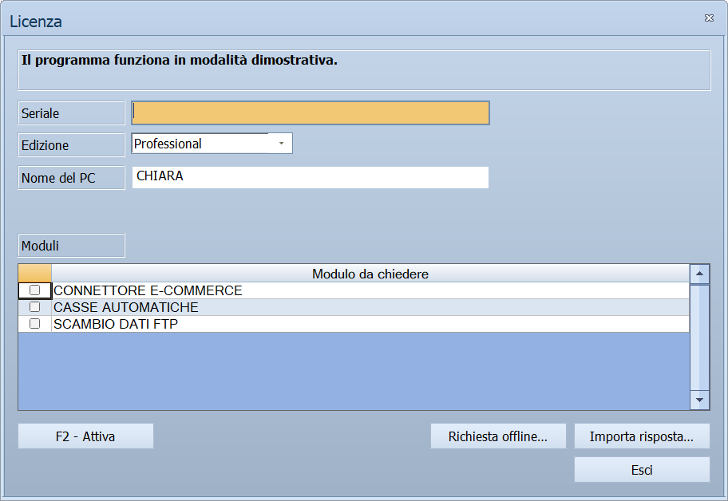
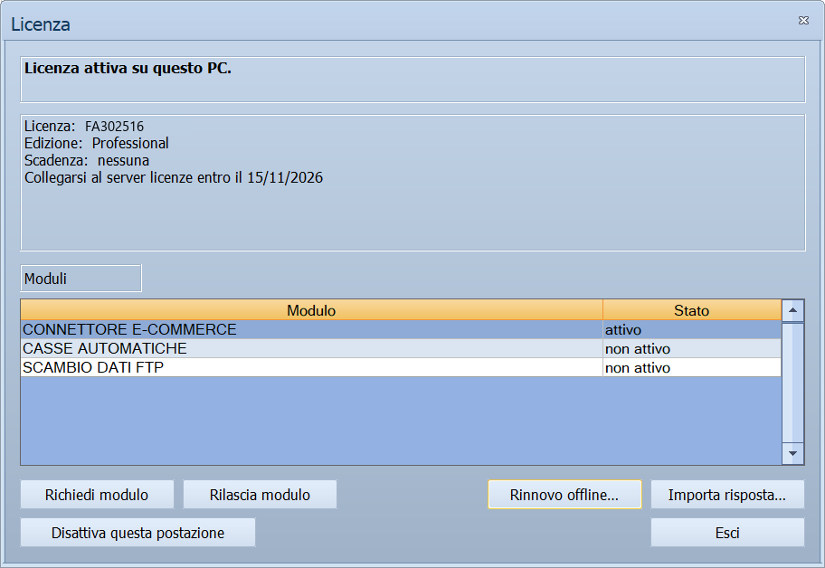
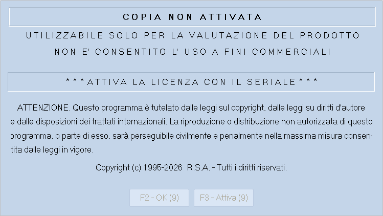
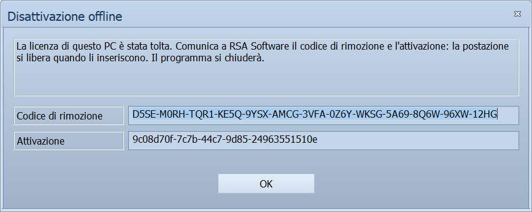

# Licenza

Facile si attiva con la **licenza digitale**: un seriale che vale per tutte le
postazioni della licenza e si scrive una volta su ogni PC. Da questa finestra
si attiva il PC, si scelgono i moduli da usare su questa postazione, si
lavora senza Internet con lo scambio di due file e si libera la postazione
quando si cambia computer.

!!! info "In sintesi"

    - **Percorso:** Menu ▸ Utility ▸ Licenza...
    - **Si apre anche da sola:** all'avvio, se questo PC non ha una licenza e non può lavorare in prova; dalla finestra della prova, con **F3 - Attiva**
    - **Scorciatoia:** ++f2++ attiva, ++esc++ esce
    - **Permessi richiesti:** nessun profilo predefinito; la voce di menu si abilita per ogni utente da [Archivi ▸ Utenti](../anagrafiche/utenti.md)

---

## A cosa serve

| Situazione | Cosa si fa qui |
|---|---|
| PC nuovo, collegato a Internet | Si scrive il seriale e si attiva. |
| PC senza Internet | Si crea un file di richiesta, lo si manda a R.S.A. e si importa il file di risposta. |
| Modulo acquistato in seguito | Si richiede il modulo per questa postazione, o lo si rilascia per usarlo su un'altra. |
| Cambio di computer | Si disattiva questa postazione, così la licenza si può attivare sull'altro PC. |

L'**edizione** della licenza decide **quali voci di menu si vedono**: Lite,
Small, Professional ed Evolution mostrano menu via via più ampi. Questo
manuale descrive il menu completo. In prova il programma è completo (come
Evolution), ma senza moduli a pagamento e senza i listini dei tabacchi.

## Prerequisiti

- **Il seriale** ricevuto per email, nella forma `RSA-FACILE-XXXX-XXXX-XXXX-XXXX`.
- **Il PC collegato a Internet**, almeno per l'attivazione. Senza Internet si
  attiva con i file (vedi sotto).

## La maschera

Prima dell'attivazione la finestra mostra in alto la situazione del PC e,
sotto, i campi per attivarlo.

Dopo l'attivazione mostra il riepilogo della licenza di questo PC e l'elenco
dei moduli con il loro stato.

Finché il programma non è attivato funziona **in prova**. Dopo i primi
quindici giorni, ogni tanto, all'apertura di una finestra compare la
**finestra della prova**: i pulsanti si abilitano dopo qualche secondo;
**F3 - Attiva** apre la finestra Licenza, **F2 - OK** continua il lavoro.
Con il passare dei giorni la finestra della prova compare più spesso, fino a
comparire ogni volta.

## Campi

### Prima dell'attivazione

| Campo | Obbl. | Descrizione | Valori ammessi |
|---|:---:|---|---|
| **Seriale** | ● | Il seriale della licenza. Si può incollare così com'è nell'email: spazi e lettere minuscole non contano. | `RSA-FACILE-XXXX-XXXX-XXXX-XXXX` |
| **Edizione** | ● | L'edizione acquistata. | Lite, Small, Professional, Evolution |
| **Nome del PC** | | Il nome con cui R.S.A. vede la postazione. Propone il nome di Windows: cambialo se vuoi riconoscere meglio la postazione. | testo |
| **Moduli** | | I moduli acquistati da usare su questo PC: si spuntano. | CONNETTORE E-COMMERCE, CASSE AUTOMATICHE, SCAMBIO DATI FTP, ETICHETTE ELETTRONICHE |

### Dopo l'attivazione

Il riepilogo riporta **Licenza**, **Cliente**, **Edizione**, **Scadenza** (o
*nessuna*) e la data entro cui il programma deve **collegarsi al server
licenze**: lo fa da solo all'avvio; se non ci riesce per molto tempo, te lo
ricorda. Un PC attivato con i file riporta *Attivazione offline*.

L'elenco **Moduli** dice per ogni modulo se è *attivo* o *non attivo* su
questo PC.

## Pulsanti e comandi

| Comando | Scorciatoia | Effetto |
|---|---|---|
| **F2 - Attiva** | ++f2++ | Attiva il PC con il seriale, l'edizione e i moduli spuntati. |
| **Richiedi modulo** | | Aggiunge a questo PC il modulo selezionato, se ce n'è uno libero fra quelli acquistati. |
| **Rilascia modulo** | | Toglie a questo PC il modulo selezionato, che si può usare su un'altra postazione. |
| **Richiesta offline…** | | Salva il file di richiesta (.req) da mandare a R.S.A. Dopo l'attivazione si chiama **Rinnovo offline…**. |
| **Importa risposta…** | | Importa il file di risposta (.rsp) di R.S.A. |
| **Disattiva questa postazione** | | Libera la postazione: la licenza si può attivare su un altro PC. Il programma si chiude. |
| **Esci** | ++esc++ | Chiude la finestra. |

## Come si fa

### Attivare il PC con il seriale

1. Apri **Menu ▸ Utility ▸ Licenza...**.
2. Scrivi il seriale in **Seriale**.
3. Scegli l'**Edizione** acquistata.
4. Spunta nell'elenco **Moduli** quelli da usare su questo PC.
5. Premi **F2 - Attiva**: il programma risponde *Licenza attivata.* e la finestra mostra il riepilogo.

### Attivare un PC senza Internet

1. Apri la finestra Licenza, scrivi il seriale e scegli l'edizione.
2. Premi **Richiesta offline…** e salva il file .req: *Invia il file a RSA Software; riceverai un file .rsp da importare qui.*
3. Manda il file .req a R.S.A. per email.
4. Quando ricevi il file .rsp, premi **Importa risposta…** e sceglilo: il programma risponde *Licenza attivata.*

Un PC attivato così non ha bisogno di collegarsi. Per aggiornarne la licenza
(per esempio dopo l'acquisto di un modulo) si usa lo stesso scambio di file,
con **Rinnovo offline…**.

### Usare un modulo acquistato dopo l'attivazione

1. Apri la finestra Licenza.
2. Seleziona il modulo nell'elenco e premi **Richiedi modulo**: il programma risponde *Moduli aggiornati.* e il modulo risulta *attivo*.

### Passare dalla licenza precedente

Su un PC dove il programma era già attivato con la licenza precedente non c'è
niente da fare: al primo avvio con il PC collegato a Internet il passaggio
alla licenza digitale avviene da solo, con la stessa edizione e gli stessi
moduli, e il programma lo dice: *Questo PC è passato alla licenza digitale.*

Senza Internet, premi **Richiesta offline…** lasciando vuoto il seriale: il
file .req chiede il passaggio, il resto è come per l'attivazione senza
Internet.

### Spostare la licenza su un altro PC

1. Sul PC che lasci, apri la finestra Licenza e premi **Disattiva questa postazione**.
2. Conferma: il programma si chiude e la postazione è libera.
3. Sul PC nuovo attiva la licenza con il seriale.

Se il PC che lasci non è collegato a Internet, il programma propone la
disattivazione offline e mostra due codici, il **Codice di rimozione** e
l'**Attivazione**: comunicali a R.S.A., che libera la postazione.

## Controlli e messaggi

| Messaggio | Causa | Cosa fare |
|---|---|---|
| *Il seriale non è scritto correttamente.* | Il seriale non ha la forma giusta. | Ricopialo dall'email. |
| *Seriale non riconosciuto per questo programma.* | Il seriale non esiste, o è di un altro programma. | Controlla l'email; altrimenti contatta R.S.A. |
| *Non ci sono postazioni libere per l'edizione Professional. Libere: Lite 0, Small 0, Evolution 0.* | Tutte le postazioni di quell'edizione sono già attivate. Il messaggio cambia con l'edizione e indica le postazioni libere delle altre. | Disattiva una postazione che non usi più, o scegli un'edizione con postazioni libere. |
| *Il server licenze non risponde. Controlla la connessione o usa l'attivazione offline.* | Il PC non raggiunge il server delle licenze. | Controlla la connessione, oppure usa **Richiesta offline…**. |
| *Troppi tentativi: riprova fra 30 minuti.* | Troppi seriali sbagliati di seguito. I minuti cambiano. | Aspetta e riprova. |
| *La licenza è corrotta. Contatta RSA Software.* | La licenza non è più valida per questo programma. | Contatta R.S.A. |
| *La licenza è revocata. Contatta RSA Software.* | La licenza è revocata. | Contatta R.S.A. |
| *La licenza è scaduta. Contatta RSA Software.* | La licenza è scaduta. | Contatta R.S.A. |
| *La licenza è scaduta il 30/11/2026: il programma funziona in modalità dimostrativa finché non la rinnovi.* | La licenza è scaduta: lo dice all'avvio, o mentre lavori quando il programma si collega al server licenze. La data cambia con la licenza; quando la scadenza è stata fissata dopo l'ultimo collegamento, il messaggio è senza data: *La licenza è scaduta: il programma funziona in modalità dimostrativa finché non la rinnovi.* | Il programma continua in prova; contatta R.S.A. per il rinnovo. |
| *Il file non è una risposta valida per questo PC.* | Il file .rsp importato non è di questo PC o è rovinato. | Importa il file giusto o richiedilo a R.S.A. |
| *Modulo non disponibile: SCAMBIO DATI FTP (acquistati 1, in uso su CASSA 2).* | Il modulo è già usato su un'altra postazione. Il messaggio cambia con il modulo. | Rilascia il modulo sull'altro PC, o acquistane un altro. |
| *Questo PC è passato alla licenza digitale.* | Al primo avvio la licenza precedente del PC è stata convertita. | Nessuna azione. |
| *La licenza precedente di questo PC non è più valida: inserisci il seriale.* | Il passaggio automatico non è possibile. | Attiva il PC con il seriale. |
| *Disattivare questa postazione? La licenza potrà essere usata su un altro PC. Il programma si chiuderà.* | Conferma della disattivazione. | Rispondi **Sì** per liberare la postazione. |
| *La funzione scambio dati FTP non è abilitata su questo PC. Per abilitarla rivolgiti a R.S.A. Software: rsa@rsaweb.com, tel. 0941 563653.* | Si usa una funzione di un modulo a pagamento che questo PC non ha. Il nome cambia con il modulo (connettore e-commerce, casse automatiche, scambio dati FTP, etichette elettroniche). | Contatta R.S.A. per il modulo; se è già acquistato, richiedilo con **Richiedi modulo**. |
| *Operazione 105: funzione scambio dati FTP non abilitata su questo PC. Per abilitarla rivolgersi a R.S.A. Software: rsa@rsaweb.com, tel. 0941 563653.* | Nel registro di un'operazione automatica: il PC non ha il modulo che l'operazione richiede. Numero e modulo cambiano con l'operazione; per i comandi di trasferimento ai punti vendita il testo comincia con *Comando* e il numero del comando. L'operazione non parte. | Contatta R.S.A. per il modulo; se è già acquistato, richiedilo con **Richiedi modulo**. |

All'avvio, se la licenza non permette di lavorare, compare una finestra con
il motivo e i pulsanti **Riprova**, **Licenza…** ed **Esci**:

| Messaggio | Causa | Cosa fare |
|---|---|---|
| *Il programma deve collegarsi al server licenze. Controlla la connessione a Internet e premi Riprova, oppure usa il rinnovo offline da Licenza….* | Il PC non si collega al server da troppo tempo. | Collegati a Internet e premi **Riprova**, oppure **Licenza…** ▸ **Rinnovo offline…**. |
| *La data del computer è indietro rispetto all'ultima usata dal programma. Correggi data e ora e premi Riprova.* | L'orologio del PC è indietro. | Correggi data e ora di Windows e premi **Riprova**. |
| *La release 2026 non è coperta dall'assistenza: la licenza copre fino alla 2025.* | La versione installata è più recente di quelle coperte dalla licenza. Gli anni cambiano. | Contatta R.S.A. per il rinnovo dell'assistenza. |

## Note

!!! note "I moduli a pagamento valgono per la postazione"

    Un modulo acquistato si usa sul PC a cui è assegnato: **casse
    automatiche**, **scambio dati FTP** (le voci di Trasferimenti e di Ordini
    che scambiano dati con il server FTP), **connettore e-commerce** ed
    **etichette elettroniche** (le operazioni di FacileToWeb, che si attiva
    con la licenza del PC su cui è installato Facile). Senza il modulo la
    funzione non parte e il programma lo dice; nelle operazioni automatiche
    il messaggio va nel registro dell'operazione.

    Valgono anche per le operazioni automatiche di Facile avviate
    dall'Utilità di pianificazione: lo scambio con i punti vendita
    (trasferimento e importazione delle variazioni delle fatture, dei
    documenti di vendita e carico, trasferimento dell'archivio ai punti
    vendita) vuole lo **scambio dati FTP**; l'esportazione dei dati verso
    Spree e l'importazione dei suoi ordini vogliono il **connettore
    e-commerce**.

!!! note "I listini dei tabacchi vogliono il canone di assistenza"

    Lo scarico del listino aggiornato dei tabacchi è riservato a chi è in
    regola con il canone di assistenza, e in prova non è disponibile. Vedi
    [Importazione listino](../listini-vendita/importazione-listino.md).

## Vedi anche

- [Impostazioni della postazione](impostazioni-postazione.md)
- [Ditte](../anagrafiche/ditte.md)
- [Convenzioni del manuale](../../introduzione/convenzioni.md)
