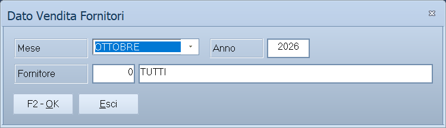

# Dato Vendita Fornitori

Da questa maschera si prepara il «dato vendita» del mese: per ogni fornitore,
quanti pezzi di ciascun articolo sono stati consegnati in ogni località, deposito
per deposito. Il risultato è un file Excel per fornitore, da mandargli.

!!! info "In sintesi"

    - **Percorso:** Menu ▸ Vendite ▸ Gestione Farmaceutica ▸ Dato Vendita Fornitori
    - **Scorciatoia:** nessuna
    - **Permessi richiesti:** nessun profilo predefinito; la voce si abilita per ogni utente da [Archivi ▸ Utenti](../anagrafiche/utenti.md)

---

## A cosa serve

Chi distribuisce in conto deposito deve dire a ogni fornitore, a fine mese,
quanta della sua merce è uscita e dove, perché il fornitore possa riordinare. La
maschera raccoglie i DDT trasfert del mese, toglie i resi dei clienti e scrive
per ogni fornitore un file con una riga per località e articolo e una colonna
di quantità per ogni deposito.

Le farmacie non sono nominate: il file dice solo CAP, località e provincia della
consegna.

## Prerequisiti

Prima di usare questa maschera occorre:

- la [gestione farmaceutica](../anagrafiche/ditte.md#attivare-la-gestione-farmaceutica)
  attiva nei dati della ditta: senza, la voce di menu non compare;
- il **Cod. Minsan** sugli [articoli](../anagrafiche/anagrafica-articoli.md), che
  va nel file;
- i fornitori sugli articoli e sui DDT: vedi
  [Emettere un DDT trasfert](documento-di-vendita.md#emettere-un-ddt-trasfert);
- il CAP sui [clienti](../anagrafiche/anagrafica-clienti.md) e sulle
  [destinazioni](../anagrafiche/destinazioni-diverse.md).

## La maschera

Una finestra sola: il mese, l'anno, il fornitore e i due pulsanti.

## Campi

| Campo | Obbl. | Descrizione | Valori ammessi |
|---|:---:|---|---|
| **Mese** | ● | Il mese del report. All'apertura è proposto il mese precedente a oggi, oppure dicembre se si lavora su un esercizio passato. | Da GENNAIO a DICEMBRE |
| **Anno** | | L'anno dell'esercizio aperto. Non si cambia da qui: per un altro anno si cambia esercizio. | Sola lettura |
| **Fornitore** | | Il fornitore di cui fare il file. Vuoto o `0` vale **TUTTI**: un file per ogni fornitore che ha movimenti nel mese. Con ++f10++, la barra spaziatrice o un doppio clic si apre l'elenco dei fornitori. | Codice dall'archivio fornitori |

## Pulsanti e comandi

| Comando | Scorciatoia | Effetto |
|---|---|---|
| **F2 - OK** | ++f2++ | Prepara i file del mese e li scrive nella cartella **out** del programma. |
| **Esci** | ++esc++ | Chiude la maschera. |
| | ++f1++ | Apre questa pagina. |
| | ++f11++ | Apre la consultazione. |
| | ++f12++ | Apre la calcolatrice. |

## Come si fa

### Preparare il dato vendita del mese

1. Apri **Menu ▸ Vendite ▸ Gestione Farmaceutica ▸ Dato Vendita Fornitori**.
2. Scegli il **Mese**.
3. Lascia **Fornitore** su **TUTTI**, oppure indica il fornitore che ti
   interessa.
4. Premi **F2 - OK**. Se mancano dei dati, il programma li elenca e chiede se
   creare lo stesso i file.
5. Il programma elenca i file creati e chiede se aprire la cartella. Ogni file
   si chiama `DatoVendita_<fornitore>_<AAAAMM>.xls`; se c'era già, viene
   sostituito.

### Il file

Il file è in formato Excel 97-2003, con un foglio solo, `Sheet1`, e ricalca il
modello concordato con i fornitori:

| Colonna | Contenuto |
|---|---|
| **Fornitore** | La ragione sociale del fornitore, portata a 22 caratteri, seguita da `RIORDINO`. |
| **CAP**, **Localita'**, **Provincia** | Il luogo della consegna: quello della destinazione del documento, se c'è, altrimenti quello del cliente. |
| **Des_Art** | La descrizione dell'articolo. |
| **Minsan** | Il codice Minsan dell'articolo. |
| **Quantità *deposito* *AAAAMM*** | Una colonna per **ogni deposito** dell'anagrafica, in ordine di codice, anche se nel mese è vuota. L'intestazione è la descrizione del deposito seguita dal periodo, per esempio `Quantità DM202610`. |

Le prime sei colonne sono testo, così il CAP e il Minsan tengono gli zeri
iniziali; le quantità sono numeri interi. Le righe sono in ordine di CAP,
località e articolo.

Le quantità si contano così:

- entrano le righe dei **DDT con Tipo Vendita `T`** del mese intestati a
  clienti, esclusi quelli annullati;
- si **sottraggono** le righe dei **resi da cliente** dello stesso mese;
- gli omaggi contano come pezzi usciti; le righe senza codice articolo non
  contano;
- una riga che i resi riportano a zero in tutti i depositi non compare.

Ogni riga va al **fornitore del DDT**, quello comune a tutti gli articoli. Per
i resi, e per i DDT che il fornitore non l'hanno registrato perché salvati
prima di questa versione, vale il fornitore abituale dell'articolo.

## Controlli e messaggi

| Messaggio | Causa | Cosa fare |
|---|---|---|
| *Nel mese scelto ci sono dati mancanti:  …  Vuoi creare lo stesso i file?* | Prima di scrivere, il programma ha trovato dati mancanti e li elenca, al massimo venti: *Articolo …: manca il Codice Minsan.*, *Cliente …: manca il CAP.* (o *Cliente …, destinazione …: manca il CAP.*), *Articolo …: non ha il fornitore, la riga resta fuori.* La risposta preimpostata è **No**. | **No** per completare prima l'anagrafica e rifare il report; **Sì** per creare i file così. Le righe di un articolo senza fornitore restano comunque fuori: non saprebbero in quale file andare. |
| *Nel mese scelto non ci sono DDT trasfert né resi da cliente.* / *Nel mese scelto non ci sono DDT trasfert né resi da cliente per questo fornitore.* | Nel mese non c'è niente da riportare: per nessun fornitore, o per quello indicato. | Controlla il mese, o il fornitore. |
| *File creati nella cartella out:  … Vuoi aprire la cartella?* | I file sono pronti; il messaggio li elenca con il percorso completo. | **Sì** apre la cartella. |
| *Impossibile scrivere il file  …  …* | Il file non si è potuto salvare, di solito perché è aperto in Excel. | Chiudi il file in Excel e premi di nuovo **F2 - OK**. |
| *Impossibile inizializzare il file excel!* | Il componente che scrive i file Excel non si è avviato. | Segnala all'assistenza. |

## Note

!!! warning "I file del mese si sovrascrivono"

    Rifacendo il report dello stesso mese, i file con lo stesso nome vengono
    sostituiti senza chiedere. Se ne hai già mandato uno al fornitore e vuoi
    tenerlo, copialo altrove prima.

## Vedi anche

- [Documento di vendita: emettere un DDT trasfert](documento-di-vendita.md#emettere-un-ddt-trasfert)
- [Ditte: attivare la gestione farmaceutica](../anagrafiche/ditte.md#attivare-la-gestione-farmaceutica)
- [Anagrafica articoli](../anagrafiche/anagrafica-articoli.md)
- [Depositi](../magazzino/depositi.md)
