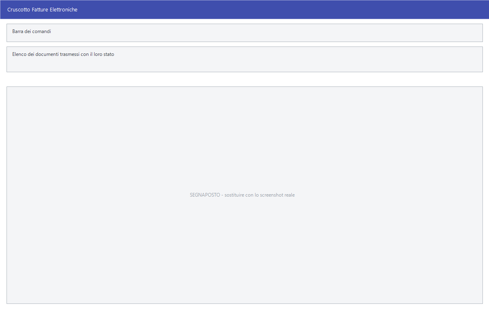

# Fatture elettroniche attive

Le fatture emesse vanno trasmesse per via elettronica e il loro esito va
seguito. **Invio Massivo** le manda in blocco, il **Cruscotto** mostra a che
punto sono.

!!! info "In sintesi"

    - **Percorso:**
        - Menu ▸ Vendite ▸ Fatture ▸ Invio Massivo Fatture Elettroniche
        - Menu ▸ Vendite ▸ Fatture ▸ Cruscotto Fatture Elettroniche
    - **Scorciatoia:** ++f2++ avvia, ++esc++ esce
    - **Permessi richiesti:** nessun profilo predefinito; le singole voci di menu si abilitano per ogni utente da [Archivi ▸ Utenti](../anagrafiche/utenti.md); serve anche **Abilita download Stati Fatture Attive** sull'utente

---

## A cosa serve

**Invio Massivo Fatture Elettroniche** prende le fatture emesse e non ancora
trasmesse e le manda tutte insieme, invece di una per volta dal documento.

**Cruscotto Fatture Elettroniche** è il quadro degli esiti: quali sono partite,
quali sono state accettate, quali scartate e vanno rifatte.

## Prerequisiti

Prima di usare queste maschere occorre:

- avere emesso le [fatture](documento-di-vendita.md) con il **Tipo Documento**
  giusto;
- avere i dati fiscali dei clienti completi, compreso il codice destinatario o
  la PEC;
- avere **credito** sul servizio di trasmissione;
- avere l'utente abilitato al download degli stati: è l'unica condizione per
  sincronizzare, da qualsiasi computer.

## La maschera

Sono due finestre a griglia: l'elenco dei documenti con il loro stato, e i
comandi per mandarli e per aggiornare gli esiti.

Sono **due finestre diverse**, una per mandare e una per seguire.

**Invio Fatture Emesse** ha in alto i filtri, e sotto una griglia con le
fatture da mandare: si spuntano quelle che interessano e si preme *Invio*.

**Cruscotto Fatture PA** ha in alto i filtri e sotto **due griglie**: quella
grande con le fatture — numero, data, cliente, partita IVA, totale e stato —
e sotto, per la fattura selezionata, quella degli **esiti**: un'icona, la data,
l'ora, lo **Stato** e il **Messaggio**. Gli esiti cambiano scorrendo le righe
della griglia di sopra.

## Campi

### Invio Fatture Emesse

| Campo | Obbl. | Descrizione | Valori ammessi |
|---|:---:|---|---|
| **Data Iniziale**, **Data Finale** | | Il periodo delle fatture da elencare. | date |
| **Cliente** | | Restringe a un cliente. | codice |
| **Visualizza documenti già inviati** | | Mostra anche quelle già trasmesse, che di norma spariscono dall'elenco. | attivo/non attivo |

### Cruscotto Fatture PA

| Campo | Obbl. | Descrizione | Valori ammessi |
|---|:---:|---|---|
| **Data Iniziale**, **Data Finale** | | Il periodo. | date |
| **Filtra** | | Restringe l'elenco a quelle andate male. | `TUTTE`, `SCARTATE DIGITHUB`, `SCARTATE SDI` |

!!! tip "I due scarti non sono la stessa cosa"

    **SCARTATE DIGITHUB** sono quelle fermate dall'intermediario prima di
    partire; **SCARTATE SDI** quelle partite e respinte dal Sistema di
    Interscambio. Le prime si correggono e si rimandano subito; le seconde
    hanno un esito ufficiale da leggere.

Non applicabile.

## Pulsanti e comandi

### Invio Fatture Emesse

| Comando | Scorciatoia | Effetto |
|---|---|---|
| **Selez. Tutti**, **Deselez. Tutti** | | Spunta o toglie la spunta a tutte le righe. |
| **F2 - Invio** | ++f2++ | Manda le fatture spuntate. |
| **F3 - Esporta** | ++f3++ | Salva il documento in XML. |
| **F4 - Modifica Doc.** | ++f4++ | Apre il documento selezionato. |
| **F5 - Modifica Cliente** | ++f5++ | Apre il cliente del documento, per correggerne i dati. |
| **F6 - Email** | ++f6++ | Manda la fattura per email. |
| **F7 - Trova** | ++f7++ | Cerca nella griglia. |

### Cruscotto Fatture PA

| Comando | Scorciatoia | Effetto |
|---|---|---|
| **F2 - Sincronizza** | ++f2++ | Scarica gli esiti nuovi e aggiorna lo stato delle fatture. Compare solo se sull'utente è acceso **Abilita download Stati Fatture Attive**; la stessa operazione parte anche da sola all'apertura (vedi le note). Durante il lavoro il pulsante diventa **Interrompi**. |
| **F3 - Credito Residuo** | ++f3++ | Calcola quante trasmissioni restano. |
| **F4 - Esporta** | ++f4++ | Esporta in XML. |
| **F5 - Trova** | ++f5++ | Cerca nella griglia. |
| **F6 - https://fatture.facilecloud.net** | ++f6++ | Apre il portale nel browser. Compare solo se il codice cliente per le fatture PA è impostato sulla ditta. |
| doppio clic su una riga degli esiti | | Se l'esito ha un allegato, propone di salvarlo: parte dalla cartella `out` dell'utente. |

Non applicabile.

## Come si fa

### Trasmettere le fatture del giorno

1. Emetti e controlla le fatture dalla
   [gestione documenti](gestione-documenti.md).
2. Apri **Menu ▸ Vendite ▸ Fatture ▸ Invio Massivo Fatture Elettroniche**.
3. Avvia l'invio.
4. Il giorno dopo apri il **Cruscotto** e controlla gli esiti.

### Aggiornare gli esiti

1. Apri il **Cruscotto Fatture Elettroniche**: se l'utente è abilitato, la
   sincronizzazione parte da sola e mostra una barra di avanzamento.
2. Per ripeterla in qualunque momento premi **F2 - Sincronizza**.
3. Se vuoi fermarla premi **Interrompi**: i file già scaricati restano, e il
   resto viene ripreso alla sincronizzazione successiva.
4. Leggi il messaggio finale: dice quanti file sono stati sincronizzati ed
   eventuali problemi (vedi *Controlli e messaggi*).

### Rimandare una fattura già inviata

1. Dalla gestione documenti o da **Invio Fatture Emesse** avvia l'invio e
   rispondi **Sì** alla domanda *Vuoi inviare il documento ?*.
2. Se la fattura risulta già inviata, compare un avviso: leggilo con
   attenzione, perché un secondo invio dello stesso documento viene quasi
   sempre scartato come duplicato.
3. Premi **Annulla** per rinunciare, oppure **OK** per mandarla comunque.

### Rimediare a una fattura scartata

1. Nel **Cruscotto** individua il documento scartato e leggi il motivo.
2. Correggi il documento o l'anagrafica del cliente.
3. Rimanda il documento, dalla gestione documenti con **F8 - Forza Invio**
   oppure con un nuovo invio massivo.

## Controlli e messaggi

| Messaggio | Dove | Causa | Cosa fare |
|---|---|---|---|
| *Nessuna Fattura è stata selezionata per l'invio dell'Email!* | Invio | Nessuna riga spuntata. | Spuntare le fatture. |
| *Impossibile trovare il documento in archivio!* | Invio | Il documento della riga non c'è più. | Ricaricare l'elenco. |
| *Impossibile trovare il cliente in archivio!* | Invio | Il cliente è stato cancellato. | Sistemare l'anagrafica. |
| *Registro Fatture PA non impostato sulla Ditta!* — e le gemelle su causale contabile, sezione e note di credito | Invio | Mancano le impostazioni fiscali per le fatture PA, o quelle del documento non coincidono. | Rispondere **No** e sistemare [Ditte](../anagrafiche/ditte.md); continuare manda un documento che può essere scartato. |
| *La fattura risulta già consegnata: un nuovo invio sarà scartato come duplicato. Per correggerla emetti una nota di credito.* | Invio | La fattura è già stata consegnata al cliente e si sta per mandarla di nuovo. L'avviso non blocca: ha i pulsanti **OK** e **Annulla**. | **Annulla**, e per correggere la fattura emettere una nota di credito. **OK** solo se sai perché serve un secondo invio. |
| *La fattura è già stata inviata e l'esito non è ancora arrivato: un nuovo invio sarà quasi certamente scartato come duplicato.* | Invio | La fattura è già stata mandata, ma la sincronizzazione non ha ancora portato l'esito. Anche questo avviso non blocca. | Premere **Annulla**, sincronizzare dal Cruscotto con **F2 - Sincronizza** e controllare l'esito; mandarla di nuovo solo se è stata scartata. |
| *Sincronizzazione completata: …* seguito dal numero di file | Cruscotto | È il riepilogo di fine sincronizzazione, con il numero di file scaricati. Può essere anche 0 se non c'era niente di nuovo. All'apertura del cruscotto compare solo se c'è qualcosa da dire. | — |
| *Sincronizzati … file su …: connessione persa, i rimanenti saranno scaricati alla prossima sincronizzazione.* | Cruscotto | La linea è caduta e le riprese automatiche non sono bastate. | Niente: quello che manca verrà scaricato alla prossima sincronizzazione. Se si ripete, controllare la connessione. |
| *Sincronizzazione interrotta: sincronizzati … file su …, i rimanenti saranno scaricati alla prossima sincronizzazione.* | Cruscotto | Hai premuto **Interrompi**. | Niente: il lavoro fatto resta e il resto riprende alla prossima sincronizzazione. |
| *File non scaricati per un errore: …. Restano sull'FTP e saranno riprovati alla prossima sincronizzazione.* | Cruscotto | Alcuni file non si sono potuti scaricare. | Niente: saranno riprovati; se il numero non cala, contattare l'assistenza. |
| *Accesso all'FTP di Digithera rifiutato: controllare le credenziali.* | Cruscotto | Il servizio non ha accettato la password del collegamento. | Controllare il collegamento nella scheda **Fatture Elettroniche** di [Ditte](../anagrafiche/ditte.md). |
| *Notifiche rimesse sulla fattura giusta: …. Stati corretti: ….* | Cruscotto | Riepilogo della riparazione che si fa una sola volta per ogni anno (vedi le note). | — |
| *Riparazione interrotta, riprende alla prossima sincronizzazione.* seguito dal riepilogo precedente | Cruscotto | La riparazione è stata fermata prima della fine. | Niente: riprende da sola alla prossima sincronizzazione. |
| *Reinvio scartato come duplicato: al cliente è arrivata la versione del primo invio* | Cruscotto, griglia degli esiti, colonna **Messaggio** | La fattura è stata mandata una seconda volta e il Sistema di Interscambio ha scartato il secondo invio perché già consegnato. | Niente: la consegna del primo invio resta valida e lo stato della fattura non cambia. |
| *Credito Esaurito!* | Cruscotto | Finite le trasmissioni disponibili. | Acquistare credito. |
| *Errore di comunicazione! Impossibile contattare l'Authorization Server.* | Cruscotto | Rete o servizio non raggiungibile. | Attendere qualche minuto e riprovare. |
| *Partita Iva Ditta non impostata!* / *Codice Abilitazione Invio Fatture Elettroniche non impostato!* | Cruscotto | Manca un dato sulla ditta. | Compilarlo in [Ditte](../anagrafiche/ditte.md). |
| *Autenticazione Fallita!* | Cruscotto | Con **F6** il programma accede al servizio delle fatture elettroniche prima di aprire il portale, e il servizio ha rifiutato l'accesso. | Riprovare; se si ripete, contattare l'assistenza. |
| *Mancata risposta dal server!* | Cruscotto | Con **F6** il servizio delle fatture elettroniche non ha risposto. | Controllare la connessione a Internet e riprovare. |
| *POST -> Response status code = …* | Cruscotto | Con **F6** il servizio ha risposto con un errore; il numero è il codice dell'errore. | Riprovare; se si ripete, comunicare il numero all'assistenza. |
| *Esportazione Conclusa!* | entrambe | L'XML è stato scritto. | — |

Non applicabile.

## Note

!!! note "Lo stato si vede anche nella gestione documenti"

    La colonna **Sync** della [gestione documenti](gestione-documenti.md) dice
    se il documento è stato preso in carico, e **F8 - Forza Invio** lo rimanda.
    Il cruscotto serve quando si vuole il quadro d'insieme.

!!! info "La sincronizzazione parte da sola, ma non da tutti"

    Quando apri il cruscotto, se sull'utente è acceso **Abilita download Stati
    Fatture Attive**, gli esiti vengono scaricati subito, con una barra di
    avanzamento e il pulsante **Interrompi**. Se non c'è niente di nuovo e il
    collegamento non è impostato, non compare nessun messaggio. Con **F2 -
    Sincronizza** si ripete a mano quando si vuole.

    Non esiste più un computer "unico" abilitato: basta il permesso
    sull'utente, e si può sincronizzare da qualsiasi postazione. Il
    campo sulla [ditta](../anagrafiche/ditte.md) che indicava il computer non
    ha più alcun effetto.

    La sincronizzazione automatica all'apertura si può disattivare su un
    singolo computer: chiedere all'assistenza.

!!! note "Se la linea cade, il lavoro riprende"

    Se la connessione si interrompe durante lo scarico, il programma ritenta da
    solo qualche volta, con una breve pausa tra un tentativo e l'altro. Se non
    basta, si ferma e dice quanti file ha sincronizzato; i rimanenti vengono
    scaricati alla sincronizzazione successiva, senza rifare quelli già fatti.

!!! note "Come si decide lo stato di una fattura"

    Lo stato mostrato è quello dell'**ultimo invio**. Quando arrivano più esiti
    vale quello più significativo, in quest'ordine: scarto, esito del
    committente (accettata o rifiutata), decorrenza dei termini, consegna,
    mancata consegna o impossibilità di recapito, conservazione, firma, presa
    in carico.

    Se una fattura viene mandata una seconda volta e il secondo invio è
    scartato come duplicato, **la consegna del primo invio non si cancella**:
    la fattura resta consegnata. La **conservazione** compare come stato solo
    quando non c'è un esito vero.

!!! info "La prima volta in un anno può volerci qualche minuto"

    Quando si entra per la prima volta in un anno, la sincronizzazione fa una
    riparazione una tantum: rimette le notifiche sulla fattura giusta e corregge
    gli stati sbagliati. Al termine ne dice il risultato. La prima volta può
    richiedere qualche minuto; se la interrompi, riprende dal punto in cui era
    arrivata.

!!! tip "Il motivo dello scarto sta nella griglia di sotto"

    Selezionando la fattura nella griglia grande, quella in basso mostra la sua
    storia: una riga per esito, con **Stato** e **Messaggio**. Il motivo dello
    scarto è il testo della colonna **Messaggio** dell'ultimo esito.

    Se l'esito ha un allegato — la ricevuta ufficiale — il **doppio clic** sulla
    riga propone di salvarlo, partendo dalla cartella `out` dell'utente.

## Vedi anche

- [Gestione documenti](gestione-documenti.md)
- [Documento di vendita](documento-di-vendita.md)
- [Fatture elettroniche passive](../contabilita/fatture-elettroniche-passive.md)
