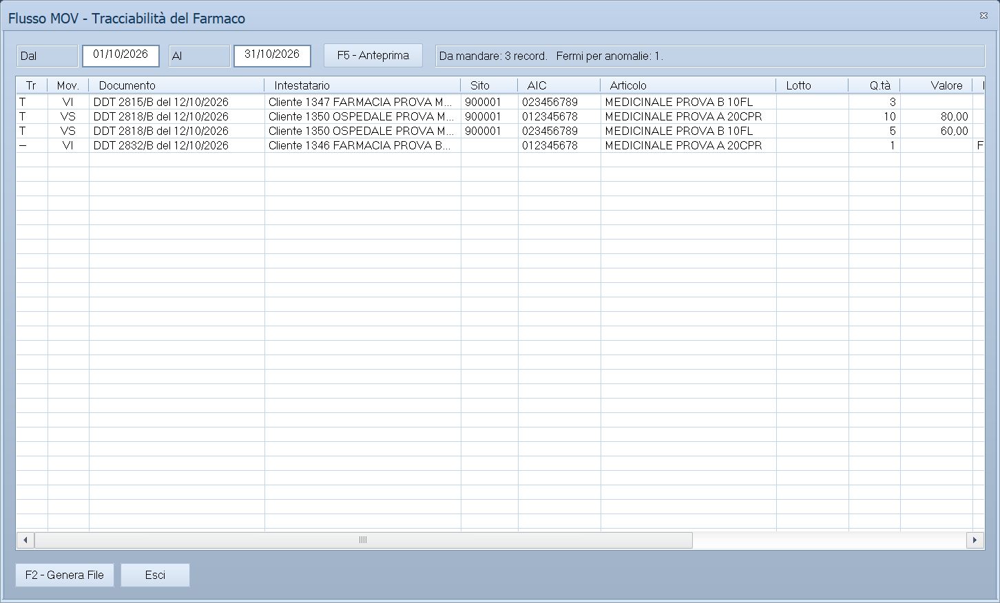

# Flusso MOV

Da questa maschera si prepara il file **MOV** che il distributore di medicinali
manda al Ministero della Salute per la tracciabilità del farmaco: le confezioni
uscite verso farmacie, ospedali e altri distributori, e quelle rientrate con i
resi. Il programma decide da solo cosa mandare per la prima volta, cosa
rettificare e cosa cancellare, e scrive il file nel formato del Ministero.

!!! info "In sintesi"

    - **Percorso:** Menu ▸ Vendite ▸ Gestione Farmaceutica ▸ Flusso MOV
    - **Scorciatoia:** nessuna
    - **Permessi richiesti:** nessun profilo predefinito; la voce si abilita per ogni utente da [Archivi ▸ Utenti](../anagrafiche/utenti.md)

---

## A cosa serve

I movimenti dei medicinali vanno comunicati entro 24 ore dalla spedizione. Ogni
giorno, o più volte al giorno, si apre la maschera, si guarda l'anteprima, si
genera il file e lo si carica sul portale NSIS del Ministero. Il programma ricorda
in un [registro](registro-trasmissioni-mov.md) tutto quello che ha messo nei file:
così, se un documento già comunicato cambia, alla generazione successiva manda la
rettifica o la cancellazione giusta, con i dati identici a quelli del primo invio
come vogliono le specifiche del Ministero.

## Prerequisiti

Prima di usare questa maschera occorre:

- la [gestione farmaceutica](../anagrafiche/ditte.md#attivare-la-gestione-farmaceutica)
  attiva nei dati della ditta: senza, la voce di menu non compare;
- il **Cod. Sito NSIS** sui [depositi](../magazzino/depositi.md) da cui escono i
  medicinali;
- il **Cod. Minsan** e la casella **Soggetto a Tracciabilità** sugli
  [articoli](../anagrafiche/anagrafica-articoli.md) da comunicare;
- il **Tipo Mov. Ministero** sulle [causali di magazzino](../magazzino/causali-magazzino.md)
  dei documenti da comunicare;
- tipo e codice ministeriale su [clienti](../anagrafiche/anagrafica-clienti.md),
  [fornitori](../anagrafiche/anagrafica-fornitori.md) e, se servono,
  [destinazioni](../anagrafiche/destinazioni-diverse.md); il committente SSN sui
  clienti del Servizio Sanitario.

## La maschera

In alto il periodo, il pulsante dell'anteprima e il riepilogo; al centro l'elenco
di quello che partirebbe, una riga per articolo e lotto di ogni documento; in
basso i pulsanti.

## Campi

| Campo | Obbl. | Descrizione | Valori ammessi |
|---|:---:|---|---|
| **Dal**, **Al** | ● | Le date dei documenti da comunicare. All'apertura sono proposti gli ultimi tre giorni; se si lavora su un esercizio passato, il suo ultimo giorno. | Date dell'esercizio aperto |

Le colonne dell'elenco:

| Colonna | Contenuto |
|---|---|
| **Tr** | Il tipo di trasmissione: `T` primo invio, `R` rettifica, `E` cancellazione. `--` indica una riga ferma per anomalie, che non parte. |
| **Mov.** | Il tipo di movimento del Ministero, per esempio `VI` vendita Italia, `VS` vendita al Servizio Sanitario, `RI` reso. |
| **Documento**, **Intestatario** | Il documento di Facile e il suo cliente o fornitore. |
| **Sito** | Il codice NSIS del deposito da cui esce la merce. |
| **AIC**, **Articolo**, **Lotto** | Il medicinale, con il lotto se la riga lo ha. |
| **Q.tà**, **Valore** | Le confezioni e, solo per le forniture al Servizio Sanitario, il valore IVA compresa. |
| **Note e anomalie** | Perché parte una rettifica o una cancellazione; per le righe ferme, `FERMO:` e l'anomalia da correggere. |

## Pulsanti e comandi

| Comando | Scorciatoia | Effetto |
|---|---|---|
| **F5 - Anteprima** | ++f5++ | Riempie l'elenco con quello che partirebbe nel periodo, senza scrivere niente. |
| **F2 - Genera File** | ++f2++ | Rifà l'anteprima, scrive il file XML nella cartella **out** e registra nel registro delle trasmissioni i record che contiene. |
| **Esci** | ++esc++ | Chiude la maschera. |
| | ++f1++ | Apre questa pagina. |
| | ++f11++ | Apre la consultazione. |
| | ++f12++ | Apre la calcolatrice. |

## Come si fa

### Generare il file del giorno

1. Apri **Menu ▸ Vendite ▸ Gestione Farmaceutica ▸ Flusso MOV**.
2. Controlla il periodo **Dal** / **Al**.
3. Premi **F5 - Anteprima** e guarda l'elenco. Le righe con `FERMO:` nelle note
   non partono: correggi l'anagrafica indicata e rifai l'anteprima.
4. Premi **F2 - Genera File**. Se ci sono righe ferme, il programma chiede se
   generare il file con le altre.
5. Il programma scrive il file nella cartella **out**, con il nome suggerito dal
   Ministero, `GG_MM_AAAA_AAAAMMGG_HHMMSS.xml` (il giorno **Al**, poi data e ora di
   generazione), e propone di aprire la cartella.
6. Carica il file sul portale NSIS del Ministero e riporta l'ID di caricamento
   nel [Registro Trasmissioni MOV](registro-trasmissioni-mov.md).

### Cosa entra nel file

- I documenti di merce verso **clienti e fornitori**: DDT di ogni tipo vendita,
  bolle di accompagnamento, fatture accompagnatorie e resi da cliente. Non entrano
  le fatture differite, perché la merce è già uscita con il DDT.
- Solo i documenti **emessi** e non annullati; i resi anche solo salvati.
- Solo se la **causale di magazzino** del documento ha il **Tipo Mov. Ministero**,
  e solo le righe di articoli **Soggetti a Tracciabilità**. Le quantità dello
  stesso articolo e lotto si sommano.

### Come si compilano i dati

- **Mittente**: il codice del sito NSIS del deposito della riga, come
  distributore.
- **Destinatario**: tipo e codice ministeriale della destinazione del documento,
  se li ha; altrimenti quelli del cliente o del fornitore.
- **Tipo movimento**: quello della causale. Se il cliente ha il committente SSN,
  `VI` diventa `VS` e `RI` diventa `RT`, con il committente e, se c'è,
  l'intestatario della fattura.
- **Documento**: il numero del documento come è stampato e la sua data. Per i
  resi vale il numero del documento del cliente (**Num. Doc.** del reso) con la
  sua data; se manca, il numero del reso, come «altro documento».
- **Lotto** e **scadenza** partono se la riga li ha; nella vendita all'estero il
  lotto è obbligatorio.
- **Valore**: solo per `VS`, `RT` e `DC`, il totale delle righe IVA compresa.

### Rettifiche e cancellazioni

Il programma confronta ogni documento con quello che ha già mandato:

| Cosa è cambiato | Cosa parte |
|---|---|
| Niente | Niente |
| Il documento o la riga non erano mai partiti | `T`, il primo invio |
| Quantità, valore, scadenza o committente | `R`, la rettifica, con gli stessi dati di riconoscimento del primo invio |
| Data, numero, tipo movimento, sito o lotto | `E` del vecchio invio e `T` nuovo |
| Il destinatario | `E` di tutto il documento; il nuovo invio parte con la generazione successiva, dopo che la cancellazione è stata caricata |
| Il documento è annullato o eliminato, o la riga non c'è più | `E` |

## Controlli e messaggi

| Messaggio | Causa | Cosa fare |
|---|---|---|
| *Il deposito … non ha il codice del sito NSIS.* | Nell'elenco, riga ferma: il deposito della riga non ha il **Cod. Sito NSIS**. | Compilalo nei [depositi](../magazzino/depositi.md) e rifai l'anteprima. |
| *L'articolo … è soggetto a tracciabilità ma non ha un Codice Minsan valido.* | Riga ferma: l'articolo è tracciabile ma il Minsan manca o è sbagliato. | Correggi il **Cod. Minsan** nell'[anagrafica articoli](../anagrafiche/anagrafica-articoli.md). |
| *… non ha il tipo destinatario ministeriale.* / *… non ha il codice ministeriale.* | Riga ferma: il cliente, il fornitore o la destinazione non hanno tipo o codice ministeriale. | Compilali nella scheda **Impostazioni** del cliente o del fornitore, o nella destinazione. |
| *…: con il tipo movimento … il committente SSN è obbligatorio.* | Riga ferma: il movimento è verso il Servizio Sanitario ma il cliente non ha il committente. | Compila **Tipo Committente** e **Cod. Committente** nel cliente. |
| *Articolo …: nella vendita all'estero il lotto è obbligatorio.* | Riga ferma: movimento `VE` senza lotto. | Indica il lotto sulla riga del documento. |
| *Articolo …: la quantità non è un numero intero di confezioni.* / *Articolo …: la quantità è negativa.* | Riga ferma: il Ministero vuole confezioni intere, da zero in su. | Correggi la quantità sul documento. |
| *Nel periodo non c'è niente da mandare al Ministero.* | Nessun primo invio, rettifica o cancellazione nel periodo. | Niente: è tutto già comunicato. |
| *Ci sono … righe ferme per anomalie, elencate con FERMO nelle note: i loro documenti non partono.  Vuoi generare il file con gli altri?* | Alcuni documenti hanno anomalie. La risposta preimpostata è **No**. | **No** per correggere prima; **Sì** per mandare intanto gli altri: i documenti fermi partiranno con una generazione successiva. |
| *Il file non rispetta lo schema del Ministero e non è stato scritto:  …* | Il controllo del file contro lo schema del Ministero ha trovato un errore; il motivo è sotto. | Segnala all'assistenza il testo del messaggio. Il registro non è stato toccato. |
| *Impossibile scrivere il file  …* | Il file non si è potuto creare nella cartella **out**. | Controlla che la cartella esista e sia scrivibile. |
| *Il registro delle trasmissioni non è stato aggiornato: il file è stato cancellato.* | Il file era scritto, ma la registrazione nel registro è fallita, con l'errore mostrato prima. | Il file è stato tolto, così il registro resta allineato: rifai la generazione. |
| *File creato nella cartella out:  …  Caricalo sul portale NSIS del Ministero entro 24 ore dalla spedizione, poi riporta l'ID di caricamento nel Registro Trasmissioni MOV.  Vuoi aprire la cartella?* | Il file è pronto e i suoi record sono nel registro. | **Sì** apre la cartella. |

## Note

!!! warning "Generato vuol dire mandato"

    Appena il file è generato, il programma considera i suoi record mandati: la
    generazione successiva non li ripropone, e una modifica al documento produce
    una rettifica. Se un file non viene caricato sul portale, o il portale lo
    rifiuta, segna i suoi record come **scartati** nel
    [Registro Trasmissioni MOV](registro-trasmissioni-mov.md): alla generazione
    successiva ripartono.

Prima di essere scritto, il file viene controllato contro lo schema XSD delle
specifiche del Ministero: un file che il portale scarterebbe per la forma non
viene creato.

## Vedi anche

- [Registro Trasmissioni MOV](registro-trasmissioni-mov.md)
- [Ditte: attivare la gestione farmaceutica](../anagrafiche/ditte.md#attivare-la-gestione-farmaceutica)
- [Causali magazzino](../magazzino/causali-magazzino.md)
- [Depositi](../magazzino/depositi.md)
