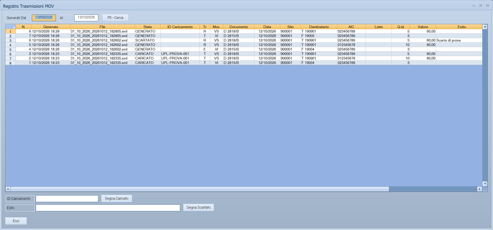

# Registro Trasmissioni MOV

Da questa maschera si consulta tutto quello che il [Flusso MOV](flusso-mov.md) ha
messo nei file per il Ministero, si riporta l'ID di caricamento che il portale NSIS
assegna a ogni file e si segnano i record che il portale ha scartato.

!!! info "In sintesi"

    - **Percorso:** Menu ▸ Vendite ▸ Gestione Farmaceutica ▸ Registro Trasmissioni MOV
    - **Scorciatoia:** nessuna
    - **Permessi richiesti:** nessun profilo predefinito; la voce si abilita per ogni utente da [Archivi ▸ Utenti](../anagrafiche/utenti.md)

---

## A cosa serve

Il registro è la memoria degli invii: ogni record mandato — primo invio,
rettifica o cancellazione — resta come è partito, e il programma lo usa per
decidere le rettifiche e le cancellazioni successive. Qui si tiene traccia del
caricamento sul portale e degli scarti, che il portale comunica solo a video.

## Prerequisiti

Prima di usare questa maschera occorre:

- la [gestione farmaceutica](../anagrafiche/ditte.md#attivare-la-gestione-farmaceutica)
  attiva nei dati della ditta: senza, la voce di menu non compare;
- almeno un file generato con il [Flusso MOV](flusso-mov.md).

## La maschera

In alto il periodo di generazione; al centro l'elenco dei record, dal più recente;
in basso i due campi per l'ID di caricamento e per l'esito, ciascuno con il suo
pulsante.

La maschera si apre larga quattro quinti della finestra di Facile e alta sette
decimi; con il pulsante di ingrandimento nella barra del titolo occupa tutto lo
schermo, e l'elenco si allarga con lei.

## Campi

| Campo | Obbl. | Descrizione | Valori ammessi |
|---|:---:|---|---|
| **Generati Dal**, **Al** | | Il periodo in cui i file sono stati generati. All'apertura è proposto l'ultimo mese. | Date |
| **ID Caricamento** | | L'identificativo che il portale NSIS ha dato al file caricato. | Fino a 30 caratteri |
| **Esito** | | Il motivo dello scarto, come lo riporta il portale. | Fino a 100 caratteri |

Le colonne dell'elenco: **N.**, **Generato** (data e ora), **File**, **Stato**
(`GENERATO`, `CARICATO`, `SCARTATO`), **ID Caricamento**, **Tr**, **Mov.**,
**Documento** (tipo e numero mandati), **Data**, **Sito**, **Destinatario**,
**AIC**, **Lotto**, **Q.tà**, **Valore** ed **Esito**.

## Pulsanti e comandi

| Comando | Scorciatoia | Effetto |
|---|---|---|
| **F5 - Cerca** | ++f5++ | Rilegge l'elenco per il periodo indicato. |
| **Segna Caricato** | | Scrive l'**ID Caricamento** su **tutti** i record del file delle righe scelte, che passano a `CARICATO`. I record già scartati restano scartati. |
| **Segna Scartato** | | Segna come `SCARTATO`, con l'**Esito** scritto, i record scelti nell'elenco. |
| **Esci** | ++esc++ | Chiude la maschera. |
| | ++f1++ | Apre questa pagina. |
| | ++f11++ | Apre la consultazione. |
| | ++f12++ | Apre la calcolatrice. |

## Come si fa

### Riportare l'ID di caricamento

1. Carica il file sul portale NSIS e annota l'ID che il portale assegna.
2. Apri **Menu ▸ Vendite ▸ Gestione Farmaceutica ▸ Registro Trasmissioni MOV**.
3. Scegli nell'elenco una riga qualsiasi di quel file.
4. Scrivi l'ID in **ID Caricamento** e premi **Segna Caricato**.
5. Tutti i record del file passano a `CARICATO`, con l'ID.

### Rimandare i record scartati dal portale

1. Nel portale, in «Monitoraggio elaborazioni», guarda il dettaglio degli scarti.
2. Nel registro scegli i record scartati: con ++ctrl++ o ++shift++ se ne scelgono
   più di uno.
3. Scrivi il motivo in **Esito** e premi **Segna Scartato**, poi rispondi **Sì**.
4. Correggi il dato sbagliato in Facile e rifai il [Flusso MOV](flusso-mov.md):
   i record scartati ripartono.

## Controlli e messaggi

| Messaggio | Causa | Cosa fare |
|---|---|---|
| *(nessun messaggio, solo un segnale acustico)* | **Segna Caricato** senza **ID Caricamento**, o **Segna Scartato** senza **Esito**, o **F5 - Cerca** con le date a rovescio. | Compila il campo su cui si è fermato il cursore. |
| *Scegli nell'elenco almeno un record del file caricato.* | **Segna Caricato** senza righe scelte. | Clicca una riga del file. |
| *Scegli nell'elenco i record scartati dal portale.* | **Segna Scartato** senza righe scelte. | Scegli le righe scartate. |
| *I record scartati si considerano mai arrivati al Ministero: alla prossima generazione ripartono.  Confermi?* | Conferma di **Segna Scartato**. La risposta preimpostata è **No**. | **Sì** segna gli scarti. |

## Note

!!! warning "Uno scarto si segna, non si cancella"

    Un record segnato come scartato per il programma non è mai arrivato al
    Ministero: alla generazione successiva riparte, come primo invio o come
    rettifica a seconda di quello che il Ministero ha già. Segna come scartati
    solo i record che il portale ha davvero rifiutato, o quelli di un file che
    hai deciso di non caricare.

## Vedi anche

- [Flusso MOV](flusso-mov.md)
- [Dato Vendita Fornitori](dato-vendita-fornitori.md)
